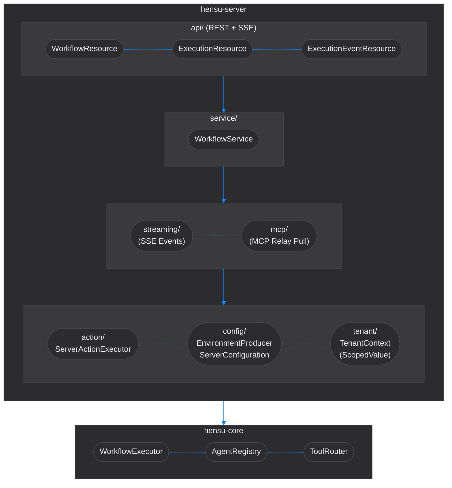
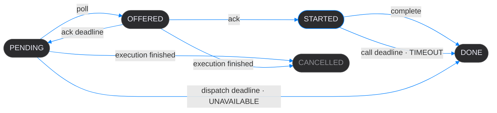

# Hensu Server Developer Guide

This guide covers the architecture, patterns, and best practices for developing the `hensu-server` module.

## Table of Contents

- [Architecture Overview](#architecture-overview)
- [Local Development](#local-development)
- [Server Initialization](#server-initialization)
- [Package Structure](#package-structure)
- [Multi-Tenancy](#multi-tenancy)
- [REST API Development](#rest-api-development)
  - [Sub-Workflow Validation on Push](#sub-workflow-validation-on-push)
- [SSE Streaming](#sse-streaming)
- [MCP Integration](#mcp-integration)
  - [Relay Protocol](#relay-protocol)
  - [Tool Catalog](#tool-catalog)
- [Testing](#testing)
  - [Integration Testing](#integration-testing)
- [Multi-Node Execution](#multi-node-execution)
  - [Manual Crash-Recovery Testing](#manual-crash-recovery-testing)
- [Pause / Resume Protocol](#pause--resume-protocol)
- [GraalVM Native Image](#graalvm-native-image)
- [Configuration](#configuration)
- [Best Practices](#best-practices)
- [See Also](#see-also)

---

## Architecture Overview

The server module extends `hensu-core` with HTTP capabilities. Core infrastructure is initialized
via `HensuFactory.builder()` - **never** by constructing components directly.



### Request Flow

1. HTTP request arrives at REST resource (`api/`)
2. Tenant ID extracted from the JWT `tenant_id` claim via `RequestTenantResolver`
3. `TenantContext` established for the request scope
4. Service layer processes business logic
5. Core engine executes workflow
6. Events broadcast via SSE to subscribed clients

---

## Local Development

### Prerequisites

- Docker (`docker-compose up -d`)
- `openssl` (keypair generation)

### Setup

**1. Configure environment**

```bash
cp .env.example .env
```

Edit `.env` — set `HENSU_DB_PASSWORD` and verify `HENSU_JWT_PUBLIC_KEY` path.
`.env` is gitignored; never commit it.

**2. Generate your JWT keypair**

Keys are personal per-developer. There is no shared dev key — every developer generates their own.

```bash
mkdir -p dev/keys

# Private key — never commit
openssl genrsa -out dev/keys/privateKey.pem 2048

# Public key — used by the server to verify tokens
openssl rsa -in dev/keys/privateKey.pem -pubout -out dev/keys/publicKey.pem
```

Both files land in `dev/keys/` (gitignored). Set `HENSU_JWT_PUBLIC_KEY=file:/absolute/path/to/repo/dev/keys/publicKey.pem` in `.env`.

**3. Start PostgreSQL**

```bash
docker-compose up -d
```

Flyway runs the `db/migration` scripts (`V1__create_schema` onward) automatically on server startup. No manual DB setup needed.

**4. Run the server**

```bash
./gradlew :hensu-server:quarkusDev
```

The `%dev` profile reads DB credentials from your environment (sourced from `.env` by your shell
or IDE). Quarkus Dev Services is disabled — the docker-compose container is used instead.

**5. Generate a dev JWT token**

```bash
TOKEN=$(bash dev/gen-jwt.sh)
```

Token is valid for 1 hour. Pass it as a Bearer header:

```bash
curl -H "Authorization: Bearer $TOKEN" http://localhost:8080/api/v1/workflows
hensu push my-workflow --token "$TOKEN"
```

### Profile Reference

| Profile  | Database                  | Auth         | Use case          |
|----------|---------------------------|--------------|-------------------|
| `%dev`   | docker-compose PostgreSQL | JWT required | Local development |
| `%inmem` | In-memory (no DB)         | Disabled     | Integration tests |
| `%prod`  | Env var `HENSU_DB_URL`    | JWT required | Production        |

---

## Server Initialization

The server **MUST** use `HensuFactory.builder()` to create core infrastructure.
This is wired through CDI in three classes:

### HensuEnvironmentProducer

Creates the `HensuEnvironment` singleton via `HensuFactory`. Conditionally wires
JDBC repositories when a DataSource is available (default), or falls back to in-memory
when the `inmem` profile disables the datasource:

```java
@Produces
@ApplicationScoped
public HensuEnvironment hensuEnvironment() {
    Properties properties = extractHensuProperties();
    HensuFactory.Builder factoryBuilder = HensuFactory.builder()
            .loadCredentials(properties)
            .agentProviders(List.of(new LangChain4jProvider()))
            .actionExecutor(actionExecutor)   // ServerActionExecutor (send-action dispatcher)
            .toolRouter(new ToolRouter(toolProviders.stream().toList())); // every ToolProvider bean

    // No workflowStateRepository: execution state is written only through ExecutionStore

    // Conditional persistence: JDBC when DataSource available, in-memory otherwise
    boolean dsActive = config.getOptionalValue("quarkus.datasource.active", Boolean.class)
            .orElse(true);
    if (dsActive && dataSourceInstance.isResolvable()) {
        factoryBuilder.workflowRepository(new JdbcWorkflowRepository(dataSourceInstance.get()));
    }

    hensuEnvironment = factoryBuilder.build();
    registerGenericHandlers();
    return hensuEnvironment;
}
```

### ServerConfiguration

Delegates `HensuEnvironment` components for CDI injection and produces server-specific beans.
The `WorkflowRepository` is created by `HensuEnvironmentProducer` (JDBC or in-memory depending on
profile) and exposed here via delegation. The execution side – `ExecutionStore` (also injected
as the `WorkflowStateReader` the queries read), `ToolIntents`, `McpCatalogs` – is produced by
`PersistenceProducer` instead, because the store must exist before the environment that its runs
use:

```java
// Core components delegated from HensuEnvironment
@Produces @Singleton
public WorkflowExecutor workflowExecutor(HensuEnvironment env) {
    return env.getWorkflowExecutor();
}

@Produces @Singleton
public AgentRegistry agentRegistry(HensuEnvironment env) {
    return env.getAgentRegistry();
}

// Workflow definitions — created by HensuFactory, delegated for CDI injection
@Produces @Singleton
public WorkflowRepository workflowRepository(HensuEnvironment env) {
    return env.getWorkflowRepository();
}

// Shared ObjectMapper with Hensu serialization support
@Produces @Singleton
public ObjectMapper objectMapper() {
    return WorkflowSerializer.createMapper();
}
```

> **Note**: Use `@Singleton` (not `@ApplicationScoped`) **only for `@Produces` delegate methods** like these. `@ApplicationScoped` creates a CDI client proxy that breaks `instanceof` checks against the concrete type returned. Regular CDI beans that are not produced via `@Produces` — service classes, scheduled jobs, handlers — should use `@ApplicationScoped`.

### ServerActionExecutor

Server-specific `ActionExecutor` that routes `Action.Send` to registered handlers and rejects `Action.Execute` (local command execution). Agent tool calls no longer reach it — those go through the `ToolRouter`. When `send.isRawPayload()` is true, template resolution is skipped to prevent exfiltration of workflow context through machine-generated arguments:

```java
@Override
public ActionResult execute(Action action, Map<String, Object> context) {
    return switch (action) {
        case Action.Send send -> executeSend(send, context);
        case Action.Execute exec -> ActionResult.failure(
            "Server mode does not support local command execution");
    };
}

private ActionResult executeSend(Action.Send send, Map<String, Object> context) {
    Map<String, Object> payload = send.isRawPayload()
            ? send.getPayload()                    // agent-originated: skip template resolution
            : resolvePayload(send, context);       // DSL-authored: resolve {variable} placeholders
    // ... handler lookup and dispatch
}
```

### Common Mistakes

- **NEVER** create `WorkflowExecutor`, `AgentRegistry`, or other core components directly
- **NEVER** create a `StubAgent` manually — `HensuFactory` has stub mode built-in
- **NEVER** create repository or store instances outside `HensuEnvironmentProducer` and `PersistenceProducer` — inject what they produce
- **NEVER** support local command execution in server mode

---

## Package Structure

```
io.hensu.server/
├── action/                # Server-specific action execution
│   └── ServerActionExecutor     # Send-action dispatcher (rejects Action.Execute)
│
├── api/                   # HTTP endpoints (REST + SSE)
│   ├── WorkflowResource        # Workflow definition management (push/pull/delete/list)
│   ├── ExecutionResource        # Execution runtime (start/resume/status/result)
│   ├── ExecutionEventResource   # Execution monitoring SSE
│   ├── McpRelayResource         # MCP relay protocol: catalog, poll, ack, complete
│   ├── ExecutionStartRequest    # Request DTO for POST /executions
│   ├── ResumeRequest            # Request DTO for POST /executions/{id}/resume
│   ├── ResumeResponse           # Response DTO for POST /executions/{id}/resume
│   ├── PushWorkflowResponse     # Response DTO for POST /workflows
│   └── WorkflowSummary          # Response DTO for GET /workflows list entries
│
├── validation/            # Input validation (Bean Validation)
│   ├── InputValidator            # Shared validation predicates (safe-ID, idempotency key, dangerous chars, size)
│   ├── ValidId                   # Custom identifier constraint annotation
│   ├── ValidIdValidator          # Regex-based validator implementation
│   ├── ValidIdempotencyKey       # Constraint for the optional Idempotency-Key header
│   ├── ValidIdempotencyKeyValidator  # Null passes; otherwise [A-Za-z0-9._:-]{1,255}
│   ├── ValidMessage              # Custom constraint for raw message body strings
│   ├── ValidMessageValidator     # Size-limit + control-character validator
│   ├── ValidWorkflow             # Custom constraint for Workflow request bodies
│   ├── ValidWorkflowValidator    # Deep-validates workflow object graph
│   ├── IllegalArgumentExceptionMapper  # Maps IllegalArgumentException → 400
│   └── ConstraintViolationExceptionMapper  # Global 400 error mapper
│
├── config/                # CDI configuration
│   ├── HensuEnvironmentProducer        # HensuFactory → HensuEnvironment
│   ├── PersistenceProducer             # Execution store, tool intents, catalogs, NOTIFY listener
│   ├── CoreModelNativeConfig               # @RegisterForReflection — Hensu domain model
│   ├── LangChain4jNativeConfig         # @RegisterForReflection — JDK HTTP transport
│   ├── LangChain4jAnthropicNativeConfig # @RegisterForReflection — Anthropic DTOs
│   ├── LangChain4jGeminiNativeConfig   # @RegisterForReflection — Gemini DTOs
│   ├── ExecutionEventNativeConfig      # @RegisterForReflection — SSE event sealed subtypes
│   └── ServerConfiguration             # CDI delegation + server beans
│
├── dev/                   # Dev-only handlers (excluded from prod image)
│   └── SleepHandler             # Simulates long-running node for crash-recovery tests
│
├── execution/             # Claims, runs, and server-side execution listeners
│   ├── Claim                      # One claim on an execution: tenant, id, epoch
│   ├── ExecutionStore             # Claim transitions and every fenced write a run makes
│   ├── RunRegistry                # Runs live on this node: renewal, preemption, drain
│   ├── RunHandle                  # A live run: its claim and whether it still stands
│   ├── RunContext                 # ScopedValue carrying the run for tool calls
│   ├── ClaimJournal               # ExecutionJournal backed by the store, under the run's claim
│   ├── CanonicalDigest            # SHA-256 of canonical JSON: replay divergence, start keys
│   ├── CheckpointingListener      # Persists checkpoints under the claim; a refused write stops the run
│   ├── LoggingExecutionListener   # Logs node lifecycle, tool audit, transition warnings
│   ├── ToolStreamingExecutionListener # Republishes tool audit events as SSE events
│   └── ToolAuditListener          # One durable row per settled tool call, paired by call id
│
├── health/
│   └── DrainingReadinessCheck   # Not ready while draining or without the database
│
├── mcp/                   # Server side of the relay protocol
│   ├── McpToolProvider          # Records a call as an intent and awaits its outcome
│   ├── ToolIntents              # Intent state machine: submit, offer, ack, complete, expire
│   ├── McpCatalogs              # Published relay catalogs, cached by content
│   └── ClusterSignals           # Wake-ups for waiting polls and calls
│
├── security/              # JWT + tenant resolution + error mapping
│   ├── GlobalExceptionMapper    # Global @Provider — normalizes errors to JSON
│   └── RequestTenantResolver    # Extracts tenant_id claim from JWT
│
├── persistence/           # PostgreSQL persistence (plain JDBC)
│   ├── JdbcWorkflowRepository         # Workflow definitions (JSONB)
│   ├── JdbcExecutionStore             # Claims, checkpoints, journal (epoch-fenced SQL), state queries
│   ├── JdbcToolIntents                # runtime.tool_intents
│   ├── JdbcMcpCatalogs                # runtime.mcp_catalogs
│   ├── PgNotificationListener         # LISTEN on the wake-up channels
│   ├── PgEventBus                     # Execution events between nodes (hensu_events)
│   ├── SnapshotRows                   # Snapshot ↔ JSONB columns
│   ├── InMemory*                      # Single-process store, intents, catalogs, audit
│   ├── WorkflowPushLock               # Cluster-wide push mutex (pg_advisory_xact_lock + JVM fallback)
│   ├── JdbcToolAuditRepository        # Tool audit rows (runtime.tool_audit)
│   ├── ToolAuditEntry                 # One settled tool call: status, argv, arguments, output
│   ├── JdbcSupport                    # JDBC helper (queryList, update)
│   └── PersistenceException           # Unchecked wrapper for SQLException
│
├── workflow/              # Business logic layer
│   ├── WorkflowService              # Facade over registry + execution + query services
│   ├── WorkflowRegistryService      # Push pipeline: WorkflowPushLock + SubWorkflowGraphValidator
│   ├── WorkflowExecutionService     # Start/resume orchestration
│   ├── ExecutionQueryService        # Read-side: status, output, paused list
│   ├── ExecutionStateService        # Claims a paused execution, then validates the resume
│   ├── ExecutionRunner              # Runs one execution under its claim
│   ├── ExecutionResultHandler       # Shared ExecutionResult → settlement + SSE dispatch
│   ├── WorkflowContextUtil          # Filters internal (_-prefixed) keys from context
│   ├── ClaimRenewalJob              # Renews this node's claims (@Scheduled)
│   ├── ExecutionPickupJob           # Resumes released and expired executions (@Scheduled)
│   ├── IntentDeadlineJob            # Offer, call and dispatch deadlines (@Scheduled)
│   ├── ExecutionStartResult / ExecutionOutput / ExecutionSummary   # DTOs
│   ├── ExecutionStatus              # DTO for execution status (with correlationId)
│   ├── ExecutionNotPausedException  # Resume of an execution that is not paused (409)
│   ├── IdempotencyKeyReusedException # Start key reused with a different request (422)
│   └── {Execution,Workflow}{NotFound,Execution}Exception   # Domain exceptions
│
├── streaming/             # Execution event streaming
│   ├── ClusterEventBus          # Carries events to subscribers on other nodes
│   ├── ExecutionEvent           # Event DTOs (sealed interface)
│   └── ExecutionEventBroadcaster # Event broadcaster
│
├── review/                # Server-side review handling
│   └── InteractiveReviewHandler  # @ApplicationScoped default ReviewHandler for workflow reviews
│
└── tenant/                # Multi-tenancy
    └── TenantContext            # ScopedValue-based context
```

---

## Multi-Tenancy

### TenantContext

Uses Java 25 `ScopedValue` for thread-safe tenant isolation:

```java
// The tenant comes from the JWT claim, never from the request body
TenantInfo tenant = TenantInfo.simple(tenantId);
TenantContext.runAs(tenant, () -> {
    // All code in this scope sees the tenant
    TenantInfo current = TenantContext.current();

    // Core engine, MCP calls, DB queries are tenant-scoped
    workflowExecutor.execute(workflow, context);
});
```

### Adding Tenant-Aware Components

1. Inject or access `TenantContext.current()` where needed
2. Use tenant ID for data isolation (DB queries, caches)
3. Key MCP intents and catalogs by tenant – a relay sees only its own tenant's

```java
@ApplicationScoped
public class TenantAwareRepository {

    public List<Workflow> findAll() {
        String tenantId = TenantContext.current().tenantId();
        return db.query("SELECT * FROM workflows WHERE tenant_id = ?", tenantId);
    }
}
```

---

## REST API Development

### API Separation

The REST API is split into two distinct resources:

1. **WorkflowResource** (`/api/v1/workflows`) - Workflow definition management (CLI integration)
   - Push, pull, delete, list workflow definitions
   - Uses `WorkflowRepository` directly

2. **ExecutionResource** (`/api/v1/executions`) - Execution runtime (client integration)
   - Start, resume, status, result
   - Uses `WorkflowService` for business logic

**Workflow deletion is a soft-delete.** `DELETE /workflows/{workflowId}` sets a `deleted_at`
timestamp rather than removing the row – hard-delete would violate FK constraints from
`execution_states` that reference the workflow. All queries filter on `deleted_at IS NULL`,
so soft-deleted workflows are invisible to the application.

**Do not mix** definition management with execution in the same resource.

### Creating a New Resource

```java
@Path("/api/v1/myresource")
@Produces(MediaType.APPLICATION_JSON)
@Consumes(MediaType.APPLICATION_JSON)
public class MyResource {

    private final MyService service;

    @Inject
    public MyResource(MyService service) {
        this.service = service;
    }

    @Inject RequestTenantResolver tenantResolver;

    @GET
    @Path("/{id}")
    public Response get(@PathParam("id") String id) {
        String tenantId = tenantResolver.tenantId();

        // Business logic via service layer
        MyEntity entity = service.findById(tenantId, id);

        return Response.ok(entity).build();
    }
}
```

### Response Conventions

| Status                    | Usage                                             |
|---------------------------|---------------------------------------------------|
| 200 OK                    | Successful GET, PUT, POST with body               |
| 201 Created               | Resource created (workflow push - new)            |
| 202 Accepted              | Async operation started (execution start)         |
| 204 No Content            | Successful DELETE                                 |
| 400 Bad Request           | Invalid input, missing headers                    |
| 403 Forbidden             | No tenant resolved from the token                 |
| 404 Not Found             | Resource not found                                |
| 409 Conflict              | Not paused; offer lapsed; already settled         |
| 422 Unprocessable Content | Idempotency key reused, different request         |
| 500 Internal Server Error | Unexpected errors                                 |
| 503 Service Unavailable   | Node cannot reach PostgreSQL (with `Retry-After`) |

### Input Validation

The server uses Bean Validation (Hibernate Validator via Quarkus) to enforce input
constraints declaratively on REST endpoint parameters and request DTOs.

#### Components

| Class                                | Role                                                                                    |
|--------------------------------------|-----------------------------------------------------------------------------------------|
| `InputValidator`                     | Shared predicates: safe-ID and idempotency-key patterns, dangerous-char detection, size |
| `@ValidId`                           | Custom constraint for path/query identifiers                                            |
| `ValidIdValidator`                   | Validates against `[a-zA-Z0-9][a-zA-Z0-9._-]{0,254}`                                    |
| `@ValidIdempotencyKey`               | Custom constraint for the optional `Idempotency-Key` header                             |
| `ValidIdempotencyKeyValidator`       | Passes null (no key sent); otherwise validates against `[A-Za-z0-9._:-]{1,255}`         |
| `@ValidMessage`                      | Custom constraint for raw `String` message bodies                                       |
| `ValidMessageValidator`              | Checks non-blank, UTF-8 byte size limit, and dangerous control chars                    |
| `@ValidWorkflow`                     | Custom constraint for full `Workflow` request bodies                                    |
| `ValidWorkflowValidator`             | Deep-validates the entire workflow object graph (IDs + free text)                       |
| `LogSanitizer`                       | Strips CR/LF from values before logging (defense-in-depth)                              |
| `ConstraintViolationExceptionMapper` | Global `@Provider` — translates violations into standardized 400 JSON                   |

All classes live in `io.hensu.server.validation`.

#### `@ValidId` Constraint

Apply `@ValidId` to every path parameter and query parameter that accepts a user-provided
identifier (`workflowId`, `executionId`, `clientId`, etc.). The constraint rejects null,
blank, and malformed strings — preventing path traversal, injection, and overly long IDs
at the API boundary.

Valid identifiers:
- Start with an alphanumeric character (`a-z`, `A-Z`, `0-9`)
- Contain only alphanumeric characters, dots (`.`), hyphens (`-`), and underscores (`_`)
- Are 1–255 characters long

#### Applying Validation

```java
// Path parameter — @ValidId validates the raw string
@GET
@Path("/{workflowId}")
public Response get(@PathParam("workflowId") @ValidId String workflowId) {
    // workflowId is guaranteed safe here
}

// Request body DTO — @Valid triggers nested validation, @NotNull rejects missing body
@POST
public Response create(@Valid @NotNull CreateRequest request) { ... }

// DTO record with field-level constraints
public record CreateRequest(
        @NotBlank(message = "workflowId is required") @ValidId String workflowId) {}
```

Validation is triggered automatically by the JAX-RS pipeline — no manual checks needed.

#### `@ValidMessage` Constraint

Apply `@ValidMessage` to raw `String` body parameters that receive free-text content (e.g., MCP
messages, chat inputs). The constraint enforces three checks:

1. **Not null or blank** — rejects missing bodies, unless `allowBlank = true`
2. **UTF-8 byte size** — must not exceed `maxBytes` (default 1 MB)
3. **No dangerous control characters** — rejects U+0000–U+0008, U+000B, U+000C, U+000E–U+001F,
   U+007F. TAB, LF, and CR are permitted since they are legitimate in free text.

Each failing condition produces a distinct violation message:

| Condition          | Violation message                             |
|--------------------|-----------------------------------------------|
| Null or blank      | `Message body is required`                    |
| Exceeds byte limit | `Message exceeds maximum allowed size`        |
| Control characters | `Message contains illegal control characters` |

```java
// Default 1 MB limit
@POST
@Consumes(MediaType.APPLICATION_JSON)
public Uni<Response> receive(@ValidMessage String body) { ... }

// Custom size limit (64 KB)
@POST
public Uni<Response> receive(@ValidMessage(maxBytes = 65_536) String body) { ... }

// Optional body: absent or blank is valid, a present body is still checked
@POST
public Response poll(@ValidMessage(maxBytes = 4096, allowBlank = true) String body) { ... }
```

The relay's `POST /mcp/v1/poll` is the endpoint with an optional body. The relay endpoints check
token formats in the resource, not with a constraint: the protocol answers a malformed token as an
unknown one (`409` on `ack`, `404` on `complete`), where a constraint violation would answer `400`.

#### Error Response Format

`ConstraintViolationExceptionMapper` catches all `ConstraintViolationException`s and returns
a standardized JSON response consistent with the `GlobalExceptionMapper` format:

```json
{"error": "workflowId: must be a valid identifier (alphanumeric, dots, hyphens, underscores; 1-255 chars)", "status": 400}
```

Multiple violations are joined with `; `.

#### Workflow Body Validation

When a `Workflow` object is submitted via `POST /api/v1/workflows`, the `@ValidWorkflow` constraint
triggers `ValidWorkflowValidator`, which deep-validates the entire object graph:

- **Identifier fields** (workflow ID, node IDs, agent IDs, branch IDs, rubric keys, etc.) must match
  the safe-ID pattern `[a-zA-Z0-9][a-zA-Z0-9._-]{0,254}`
- **Free-text fields** (prompts, instructions, rubric content, metadata) are scanned for dangerous
  control characters (U+0000–U+0008, U+000B, U+000C, U+000E–U+001F, U+007F). Tabs, newlines, and
  carriage returns are permitted since they are legitimate in prompt text.

The validator walks all node types via pattern matching (`StandardNode`, `ParallelNode`,
`SubWorkflowNode`, `ForkNode`, `JoinNode`, `GenericNode`, `EndNode`) and validates type-specific
fields (e.g., branch prompts, input/output mappings, await targets).

```java
@POST
public Response push(@ValidWorkflow Workflow workflow) {
    // workflow is guaranteed safe here — all IDs and text fields validated
}
```

#### Sub-Workflow Validation on Push

`ValidWorkflowValidator` checks the incoming workflow in isolation. Cross-workflow
consistency — cycles and dangling sub-workflow references — is a second pass handled by
`WorkflowRegistryService` before the row is written:

```java
// WorkflowRegistryService.push()
pushLock.withLock(tenantId, workflowId, () -> {
    SubWorkflowGraphValidator.validate(
            workflow,
            id -> id.equals(workflow.getId())
                    ? Optional.of(workflow)                          // incoming overrides repo
                    : repository.findById(tenantId, id));            // lazy resolution
    repository.save(tenantId, workflow);
});
```

Key properties:

- **Cluster-wide mutex** — `WorkflowPushLock` wraps the save in `pg_advisory_xact_lock`
  (JVM `ReentrantLock` fallback when `quarkus.datasource.active=false`). Without this,
  two concurrent pushes on different nodes could each observe a clean graph and together
  introduce a cycle.
- **Post-push view** — the resolver short-circuits to the incoming workflow for its own
  id, so the DFS sees the graph *as it will exist* after the push — no intermediate write
  is needed, and a push that would fix an existing cycle validates correctly.
- **Single DFS** — `SubWorkflowGraphValidator.validate(Workflow, Function)` uses one
  `globallyVisited` set for both cycle detection and dangling-ref detection.
- **Tenant-scoped resolution** — `repository.findById(tenantId, id)` never looks up
  workflows from another tenant, so a sub-workflow target that exists under a different
  tenant is rejected as dangling.
- **Runtime bounds** — even if validation passes, recursion is capped at
  `SubWorkflowNodeExecutor.MAX_DEPTH = 16` (tracked via `_sub_workflow_depth`) and
  `_tenant_id` is propagated into the child context, so a malicious deep chain cannot
  exhaust the stack and a child cannot escape its tenant boundary.

See the [hensu-core Developer Guide — `SubWorkflowGraphValidator` checks](developer-guide-core.md#subworkflowgraphvalidator-checks)
for the core-side algorithm and the CLI-only `validate(Collection<Workflow>)` overload.

#### Log Sanitizer (Defense-in-Depth)

`LogSanitizer.sanitize()` strips CR/LF characters from user-derived values before they reach log
output, preventing log injection attacks. Apply it at every log call site that includes
user-controlled input:

```java
LOG.infov("Processing workflow: id={0}", LogSanitizer.sanitize(workflowId));
```

#### Adding Validation to New Endpoints

1. Add `@ValidId` to all path/query params accepting identifiers
2. Add `@ValidIdempotencyKey` to an `Idempotency-Key` header param
3. Add `@ValidMessage` to raw `String` body params receiving free-text content
4. Add `@ValidWorkflow` to `Workflow` body parameters (or `@Valid @NotNull` for other DTOs)
5. Add field-level constraints (`@NotBlank`, `@ValidId`, `@Size`, etc.) to DTO records
6. Use `LogSanitizer.sanitize()` when logging any user-provided string
7. Write a test in `InputValidationIntegrationTest` covering the new constraints

See `hensu-server/src/test/java/io/hensu/server/integration/InputValidationIntegrationTest.java` for
comprehensive examples.

---

## SSE Streaming

### Two SSE Patterns in hensu-server

1. **ExecutionEventResource** - One-way event streaming for monitoring, per execution and per tenant

The MCP relay protocol does not use SSE: a relay long-polls `/mcp/v1/poll` (see
[MCP Integration](#mcp-integration)). An event stream works on any node: events published on the
node running the execution travel to the others on the PostgreSQL channel `hensu_events`
(`PgEventBus`), and the subscription is refused with 404 unless the execution belongs to the
caller's tenant.

### Adding New Event Types

1. Add record to `ExecutionEvent` sealed interface:

```java
public sealed interface ExecutionEvent {
    // ... existing events ...

    /// My new event type.
    record MyNewEvent(
            String executionId,
            String customField,
            Instant timestamp) implements ExecutionEvent {

        @Override
        public String type() {
            return "my.new.event";
        }

        public static MyNewEvent now(String executionId, String customField) {
            return new MyNewEvent(executionId, customField, Instant.now());
        }
    }
}
```

2. Register the record for reflection in `ExecutionEventNativeConfig`:

```java
@RegisterForReflection(targets = { /* ... */ ExecutionEvent.MyNewEvent.class })
```

This step is not optional. Quarkus resolves the JAX-RS return type to the sealed interface but does
not walk its permitted subtypes for Jackson metadata, so an unregistered record builds cleanly and
then streams every field as `null` in the native image — only `type()` survives, because its
explicit `@JsonProperty` is traced at build time.

3. Publish directly where needed:

```java
broadcaster.publish(executionId, ExecutionEvent.MyNewEvent.now(executionId, "value"));
```

### Execution Context Routing (ScopedValue)

`ExecutionEventBroadcaster` uses a `ScopedValue` — not `ThreadLocal` — to carry the current execution ID into
listener callbacks. This is mandatory for correctness with virtual threads (Project Loom).

Wrap execution blocks with `runAs()`:

```java
// ExecutionRunner — correct pattern
eventBroadcaster.runAs(executionId, () ->
        TenantContext.runAs(tenant, () ->
                RunContext.runAs(run, () ->
                        workflowExecutor.executeFrom(
                                workflow, state, listener, new ClaimJournal(store, run)))));
```

**Do not** call `broadcaster.setCurrentExecution()` — that method no longer exists. ScopedValue is structurally
scoped: the binding is automatically released when `runAs()` returns, even on exception paths.

### execution.completed Event — Output Field

The `execution.completed` SSE event now carries the final workflow output:

```json
{
  "type": "execution.completed",
  "executionId": "exec-123",
  "workflowId": "order-processing",
  "success": true,
  "finalNodeId": "end",
  "output": {
    "summary": "Order validated",
    "items": 3
  },
  "timestamp": "2024-01-01T12:00:00Z"
}
```

`output` contains the public workflow context — all keys **not** prefixed with `_`. Internal routing keys
(`_tenant_id`, `_execution_id`, `_last_output`, etc.) are stripped before publishing.

`output` may be empty `{}` if the workflow produced no public context keys.

### BroadcastProcessor Pattern

For fan-out to multiple subscribers:

```java
@ApplicationScoped
public class MyBroadcaster {

    private final Map<String, BroadcastProcessor<MyEvent>> processors =
            new ConcurrentHashMap<>();

    public Multi<MyEvent> subscribe(String channel) {
        BroadcastProcessor<MyEvent> processor = processors.computeIfAbsent(
                channel, k -> BroadcastProcessor.create());
        return processor;
    }

    public void publish(String channel, MyEvent event) {
        BroadcastProcessor<MyEvent> processor = processors.get(channel);
        if (processor != null) {
            processor.onNext(event);
        }
    }

    public void complete(String channel) {
        BroadcastProcessor<MyEvent> processor = processors.remove(channel);
        if (processor != null) {
            processor.onComplete();
        }
    }
}
```

### Retrieving the Final Workflow Output

After execution completes, clients can fetch the output via REST instead of (or in addition to) consuming the SSE
stream:

```
GET /api/v1/executions/{executionId}/result
Authorization: Bearer <jwt>
```

Response (200 OK):

```json
{
  "executionId": "exec-123",
  "workflowId": "order-processing",
  "status": "COMPLETED",
  "output": {
    "summary": "Order validated",
    "items": 3
  }
}
```

`status` is `COMPLETED` when `currentNodeId` is null in the snapshot, `PAUSED` otherwise. Internal context keys
(prefixed with `_`) are filtered the same way as in the SSE event. Returns **404** if the execution ID does not
exist for the requesting tenant.

---

## MCP Integration

### Relay Protocol

The server opens no connection to a tenant (Decision 3 of `docs/unified-architecture.md`). A tool
call is a durable **intent** in `runtime.tool_intents`, and the tenant's relay pulls it from any
node. Every request is scoped to the JWT `tenant_id` claim, never to a caller-supplied id.

| Step     | Request                               | Server side                                                                                              |
|----------|---------------------------------------|----------------------------------------------------------------------------------------------------------|
| Catalog  | `PUT /mcp/v1/catalog`                 | Stores `{version, tools}` in `runtime.mcp_catalogs`                                                      |
| Poll     | `POST /mcp/v1/poll`                   | Offers up to `max` (≤ 32) `PENDING` intents, each under a fresh single-use token, waiting up to `waitMs` |
| Ack      | `POST /mcp/v1/tasks/{token}/ack`      | `OFFERED` → `STARTED` while the offer is current: `204` execute; `409` do not                            |
| Complete | `POST /mcp/v1/tasks/{token}/complete` | `STARTED` → `DONE` with the outcome; the first outcome wins, a later one is answered `409`               |



`STARTED` is the only state in which the relay may be running the tool, and nothing moves a call out
of it but an outcome or the call deadline – an execution that finishes cancels only calls no relay
has acknowledged.

The relay contract follows from the table: **acknowledge before executing, execute only on `204`,
execute each acknowledged token once, and retry `ack` and `complete` until some node answers below
500.** Repeating an `ack` for the same token is safe and gets the same answer, and repeating a
`complete` after the first was recorded gets `409`, so a relay that lost a response simply retries
through the load balancer. Because only one token is ever acknowledged per intent, a relay that
keeps this contract executes each call at most once, however many relay instances poll.

On the run side, `McpToolProvider` inserts the intent under the run's claim epoch – a run that has
lost its claim gets `RunPreemptedException` instead – and waits for its outcome, woken by the
`hensu_outcome` notification. The call key is the attempt's journal position and the call's sequence
within it, so a recovered run that replays up to a call its predecessor made finds the existing
intent and waits for that outcome rather than issuing the call again. A relay receives the key
qualified with the execution id (`<executionId>/<position>#<sequence>`, `ToolCall.id`) – the same
identity the tool audit records – so it is unique across the tenant's executions and a relay may
de-duplicate on it. If the replayed arguments do
not match the recorded digest, the replay has diverged and the run fails with
`ReplayDivergenceException`.

| Outcome       | Meaning for the agent                                                             |
|---------------|-----------------------------------------------------------------------------------|
| `SUCCESS`     | The tool ran and returned a result                                                |
| `FAILURE`     | The tool ran and reported an error, or the relay answered with a JSON-RPC error   |
| `TIMEOUT`     | Acknowledged but not completed within `hensu.mcp.call-deadline` – it may have run |
| `UNAVAILABLE` | No relay acknowledged it within `hensu.mcp.dispatch-deadline` – it did not run    |

`IntentDeadlineJob` applies the three deadlines every second, in one statement that also notifies
the waiting runs. The [Spring reference client](../integrations/spring-reference-client/README.md)
is a complete relay.

### Using MCP in Workflows

Agents reach the tenant's MCP tools through the `ToolRouter`: `McpToolProvider` is one of the
`ToolProvider` beans `HensuEnvironmentProducer` composes into it, so a tool the relay publishes is
available to `ToolLoopRunner` with no server code change.

DSL-authored `send(...)` actions are a different path: `ServerActionExecutor` dispatches them to
registered `ActionHandler`s only, and a send naming an unregistered handler fails with "Action
handler not found". It never falls back to MCP.

### Tool Catalog

- **Source**: the catalog a tenant sees is exactly what its relay last published. Every node reads it
  from `runtime.mcp_catalogs`, so a run sees the same tools wherever it runs; `McpCatalogs` caches it
  keyed by the published content, so a republished catalog is picked up without invalidation events.
- **Version**: each poll may name the version the relay is serving; a poll naming another version is
  answered 409 and the relay republishes, so a relay restarted with a changed tool list cannot serve
  calls built against the old one.
- **Scope**: outside a tenant context, or before the tenant's relay has published, the catalog is
  empty. Collisions *between* configured providers are a configuration error the `ToolRouter`
  rejects outright; only a built-in provider yields a contested name, and the server registers none.
- **Rendering**: `McpResultRenderer` (in `hensu-mcp`) flattens the response content blocks into the
  text the agent reads, and maps the protocol's `isError` flag onto `ToolCallStatus.FAILURE`.

### Tool Audit Trail

`ToolLoopRunner` reports every tool request and its outcome to the `ExecutionListener`, and the
server consumes both callbacks so an unattended run leaves a trail an operator can read:

| Consumer                         | Sink                                                                                                                          |
|----------------------------------|-------------------------------------------------------------------------------------------------------------------------------|
| `LoggingExecutionListener`       | Server log: the request at INFO, the outcome at INFO for `SUCCESS` and WARNING otherwise, with status, duration and exit code |
| `ToolStreamingExecutionListener` | The execution's SSE stream, as `tool.invoked` and `tool.settled`                                                              |

Both sinks carry argument *names* without their values. Values can be large, can carry credentials,
and a log file and an open HTTP stream are the least controlled places to put them; the values of
parameters declared `sensitive` never leave `hensu-core` at all, having been replaced with a
placeholder by the tool loop. `ToolAuditListener` writes the durable record – one row per settled
call in `runtime.tool_audit` – keyed by the call id, which is stable across recovery, so a recovered
run that replays a call does not record it twice.

`WorkflowExecutionService` composes the streaming listener unconditionally — the SSE trail must not
depend on `hensu.verbose.enabled`, which gates only the log half — and `ExecutionStateService`
composes it on the resume path, so a client that re-subscribed after submitting a review sees the
same events a fresh execution streams.

---

## Testing

### Unit Test Pattern

```java
class MyResourceTest {

    private MyService service;
    private MyResource resource;

    @BeforeEach
    void setUp() {
        service = mock(MyService.class);
        resource = new MyResource(service);
    }

    @Test
    void shouldReturnEntityWhenFound() {
        when(service.findById("tenant-1", "id-1"))
                .thenReturn(new MyEntity("id-1", "data"));

        Response response = resource.get("id-1", "tenant-1");

        assertThat(response.getStatus()).isEqualTo(200);
        verify(service).findById("tenant-1", "id-1");
    }

    @Test
    void shouldReturn403WhenNoTenantContext() {
        // RequestTenantResolver throws ForbiddenException when no JWT tenant_id claim
        assertThatThrownBy(() -> resource.get("id-1"))
                .isInstanceOf(ForbiddenException.class)
                .hasMessageContaining("No tenant context");
    }
}
```

### Integration Test Pattern (REST)

```java
@QuarkusTest
class MyResourceIT {

    @Test
    void shouldPushWorkflow() {
        given()
            .auth().preemptive().oauth2("test-token")
            .contentType(ContentType.JSON)
            .body(workflowJson)
        .when()
            .post("/api/v1/workflows")
        .then()
            .statusCode(201)
            .body("id", notNullValue())
            .body("created", equalTo(true));
    }

    @Test
    void shouldStartExecution() {
        given()
            .auth().preemptive().oauth2("test-token")
            .contentType(ContentType.JSON)
            .body(Map.of("workflowId", "my-workflow", "context", Map.of()))
        .when()
            .post("/api/v1/executions")
        .then()
            .statusCode(202)
            .body("executionId", notNullValue());
    }
}
```

### Integration Testing

Full-stack integration tests exercise the workflow engine end-to-end within a bootstrapped Quarkus context, using the [Stub Agent System](developer-guide-core.md#stub-agent-system) to intercept all model requests. Behavior tests use the `inmem` profile (no Docker required); repository tests use Testcontainers PostgreSQL.

#### Test Infrastructure

| Class                  | Role                                                                                                     |
|------------------------|----------------------------------------------------------------------------------------------------------|
| `IntegrationTestBase`  | Abstract base: CDI injection, per-test reset, helper methods (`@TestProfile(InMemoryTestProfile.class)`) |
| `InMemoryTestProfile`  | Quarkus test profile activating `inmem` — disables PostgreSQL and Flyway                                 |
| `TestActionHandler`    | Records action payloads for action dispatch assertions                                                   |
| `TestReviewHandler`    | Scriptable review decisions (approve, backtrack, reject)                                                 |
| `TestValidatorHandler` | Generic node handler for `"validator"` type nodes                                                        |
| `TestPauseHandler`     | Generic node handler that pauses on first call, succeeds on next                                         |

All infrastructure lives in `io.hensu.server.integration` (package-private).

#### IntegrationTestBase

Every integration test extends `IntegrationTestBase`, which provides:

- **CDI-injected beans**: `workflowRepository`, `stateReader` (the `WorkflowStateReader`), `workflowService`
- **Per-test cleanup** (`@BeforeEach`): clears stub responses and the workflow repository. Executions
  are not deleted – the server offers no write to execution state outside a claim – so a test reads
  its own execution by id
- **Helper methods**:

| Method                                           | Description                                             |
|--------------------------------------------------|---------------------------------------------------------|
| `loadWorkflow(resourceName)`                     | Loads JSON fixtures from `/workflows/`                  |
| `pushAndExecute(workflow, context)`              | Saves workflow + executes under `TEST_TENANT`           |
| `snapshotOf(result)`                             | Latest snapshot of the execution `result` started       |
| `registerStub(key, response)`                    | Programmatic stub registration by node ID or agent ID   |
| `registerStub(scenario, key, response)`          | Scenario-specific stub registration                     |

#### Writing an Integration Test

```java
@QuarkusTest
class MyWorkflowIntegrationTest extends IntegrationTestBase {

    @Test
    void shouldExecuteWorkflow() {
        // 1. Load workflow fixture
        Workflow workflow = loadWorkflow("my-workflow.json");

        // 2. Register stub responses by node ID
        registerStub("research", "Research findings about the topic");
        registerStub("draft", "Article draft based on research");

        // 3. Execute
        ExecutionStartResult result = pushAndExecute(
                workflow, Map.of("topic", "AI"));

        // 4. Assert on final snapshot
        HensuSnapshot snapshot = snapshotOf(result);
        assertThat(snapshot.checkpointReason()).isEqualTo("completed");
        assertThat(snapshot.context())
                .containsEntry("research", "Research findings about the topic");
    }
}
```

Register stubs by **node ID** (e.g., `"research"`, `"draft"`), not by agent ID. The `StandardNodeExecutor` propagates the current node ID into the execution context, so `StubResponseRegistry` resolves node-ID-based stubs first. See [Stub Agent System — Response Resolution Order](developer-guide-core.md#response-resolution-order) for the full lookup chain.

#### Scripting Review Decisions

`TestReviewHandler` is a CDI `@Alternative` (priority 1) that replaces the default `AUTO_APPROVE` handler. Enqueue decisions before execution — they are consumed in FIFO order:

```java
@Inject TestReviewHandler testReviewHandler;

@BeforeEach
void resetReviewHandler() {
    testReviewHandler.reset();
}

@Test
void shouldBacktrackAndRetry() {
    Workflow workflow = loadWorkflow("review-workflow.json");
    registerStub("research", "Research");
    registerStub("draft", "Content");

    // First review: backtrack to "research" node
    testReviewHandler.enqueueDecision(
            new ReviewDecision.Backtrack("research", null, "Needs more detail"));
    // Second review: approve
    testReviewHandler.enqueueDecision(new ReviewDecision.Approve());

    ExecutionStartResult result = pushAndExecute(
            workflow, Map.of("topic", "test"));

    HensuSnapshot snapshot = snapshotOf(result);
    List<BacktrackEvent> backtracks = snapshot.history().getBacktracks();
    assertThat(backtracks).isNotEmpty();
    assertThat(backtracks.getFirst().getFrom()).isEqualTo("draft");
    assertThat(backtracks.getFirst().getTo()).isEqualTo("research");
}
```

When the queue is empty, `TestReviewHandler` falls back to a configurable default (approve by default). Use `setDefaultDecision()` to change the fallback.

#### Verifying Action Dispatch

`TestActionHandler` records all payloads dispatched to the `"test-tool"` handler ID:

```java
@Inject TestActionHandler testActionHandler;
@Inject ActionExecutor actionExecutor;

@BeforeEach
void resetActionHandler() {
    testActionHandler.reset();
    actionExecutor.registerHandler(testActionHandler);
}

@Test
void shouldDispatchActions() {
    Workflow workflow = loadWorkflow("action-workflow.json");
    registerStub("process", "Processing complete");

    pushAndExecute(workflow, Map.of("task", "test"));

    List<Map<String, Object>> payloads = testActionHandler.getReceivedPayloads();
    assertThat(payloads).isNotEmpty();
    assertThat(payloads.getFirst()).containsEntry("action", "notify");
}
```

#### Workflow JSON Fixtures

Place workflow definitions in `src/test/resources/workflows/`. Use `model: "stub"` for all agents:

```json
{
  "id": "my-workflow",
  "version": "1.0.0",
  "startNode": "process",
  "agents": {
    "writer": { "id": "writer", "role": "writer", "model": "stub", "temperature": 0.7 }
  },
  "nodes": {
    "process": {
      "id": "process",
      "nodeType": "STANDARD",
      "agentId": "writer",
      "prompt": "Write about {topic}",
      "transitionRules": [{ "type": "success", "targetNode": "done" }]
    },
    "done": { "id": "done", "nodeType": "END", "status": "SUCCESS" }
  }
}
```

#### Rubric Testing

Rubrics are parsed at build time and stored directly on workflow nodes. Workflow JSON fixtures
include inline rubric content in the `"rubric"` field, which the deserializer parses into typed
`Rubric` objects at load time. No separate registration step is needed — just call
`loadWorkflow("fixture.json")` and the rubric is ready.

#### Repository Tests (Testcontainers)

JDBC repository tests live in `io.hensu.server.persistence` and use Testcontainers PostgreSQL (no Quarkus context). They extend `JdbcRepositoryTestBase` which provides:

- A shared PostgreSQL container per test class
- Flyway migration (same `db/migration` scripts used in production)
- Pre-configured `DataSource` and `ObjectMapper`
- `deleteExecutions(tenantId)` – test-only cleanup of execution state, which the server writes only
  under a claim

```java
class JdbcWorkflowRepositoryTest extends JdbcRepositoryTestBase {

    private JdbcWorkflowRepository repo;

    @BeforeEach
    void setUp() {
        repo = new JdbcWorkflowRepository(dataSource);
        repo.deleteAllForTenant(TENANT);
    }

    @Test
    void saveAndFindById_roundTrip() {
        Workflow workflow = buildWorkflow("wf-1");
        repo.save(TENANT, workflow);

        Optional<Workflow> found = repo.findById(TENANT, "wf-1");
        assertThat(found).isPresent();
        assertThat(found.get().getId()).isEqualTo("wf-1");
    }
}
```

These tests require Docker for Testcontainers. Run them separately:

```bash
./gradlew :hensu-server:test --tests "*.persistence.*"
```

---

## Multi-Node Execution

Several nodes run behind an ordinary load balancer, all active, sharing one PostgreSQL. Which node
runs an execution is decided by a **claim** on its row, never by where a request landed, so any node
answers any request. Decision 9 of `docs/unified-architecture.md` states the guarantees;
`docs/multi-node-execution-protocol.md` has the fault model, the invariants (S1–S8, L1–L5) the code
and tests are named after, the TLA+ model and the fault-injection test.

### Claims

| `run_state` | Meaning                                         | Leaves by                                                         |
|-------------|-------------------------------------------------|-------------------------------------------------------------------|
| `RUNNING`   | A node holds a claim (`claim_epoch`, expiry)    | settle → `PAUSED` / `DONE`; release → `RUNNABLE`; expiry → pickup |
| `RUNNABLE`  | Released by a draining node; no claim           | pickup                                                            |
| `PAUSED`    | Waiting for a review decision; no claim         | `POST /resume` claims it                                          |
| `DONE`      | Completed, failed or rejected                   | –                                                                 |

Every claim – start, resume, pickup – increments `claim_epoch`, and every write a run makes
compares it in the same statement. The rules a change to this code must keep:

- **One statement per decision.** A claim transition or a fenced write is a single
  `UPDATE … WHERE claim_epoch = ? AND run_state = 'RUNNING'` (or an insert guarded by a `FOR SHARE`
  read of the execution row). Never read the claim and then write in a second statement.
- **Database time only.** Expiry is written as `now() + ttl` and compared against `now()`. Do not pass
  a node's `Instant` into any claim SQL; node clocks only schedule renewals.
- **A refused write ends the run.** `ExecutionStore` turns a refused write into
  `RunPreemptedException`. It must propagate – `ToolRouter`, `ToolLoopRunner` and the nested-flow
  executors rethrow `RunAbortedException` – and nothing records a `failed` snapshot over it.
- **Renewal is per claim.** `RunRegistry.renewAll()` renews exactly the claims of runs live on this
  node; a claim the store does not return is preempted. A node that fails to renew for longer than
  the TTL preempts all its runs.

### Components

| Class                    | Package        | Role                                                                                                 |
|--------------------------|----------------|------------------------------------------------------------------------------------------------------|
| `ExecutionStore`         | `execution/`   | Claim transitions and fenced writes; `JdbcExecutionStore` and `InMemoryExecutionStore`               |
| `RunRegistry`            | `execution/`   | Runs live on this node; renewal, preemption, and the drain on `ShutdownEvent`                        |
| `ClaimJournal`           | `execution/`   | The core `ExecutionJournal` over the store: model turns and nested-flow checkpoints, under the claim |
| `ExecutionRunner`        | `workflow/`    | Runs one execution under its claim with tenant, run and journal bound; settles the outcome           |
| `ClaimRenewalJob`        | `workflow/`    | `@Scheduled` every `${hensu.claim.renew-interval:10s}` – `registry.renewAll()`                       |
| `ExecutionPickupJob`     | `workflow/`    | `@Scheduled` every `${hensu.claim.pickup-interval:5s}` and on `hensu_runnable` – claims and resumes  |
| `IntentDeadlineJob`      | `workflow/`    | `@Scheduled` every second – offer, call and dispatch deadlines of tool intents                       |
| `PgNotificationListener` | `persistence/` | `LISTEN hensu_intent, hensu_outcome, hensu_runnable, hensu_events`; reconnects with backoff          |
| `DrainingReadinessCheck` | `health/`      | `/q/health/ready` is down while draining or when the database is unreachable                         |

### Step Journal

A checkpoint is written before each node attempt, and `HensuState.step` counts the attempts the main
flow has completed. Between checkpoints the core engine asks its `ExecutionJournal` for two kinds of
record, both keyed by **position** – the nested-flow scope plus the step:

- **Turns.** `ToolLoopRunner` journals each model answer of the attempt in progress
  (`journal.turn(position, index, live)`): the first run records the live answer, a recovered run
  gets the recorded one back and does not call the model. The tool calls a replayed answer requests
  carry the same keys (`position#sequence`) and arguments, so they find the original intents.
- **Nested-flow checkpoints.** Fork branches (`<position>/f:<target>/`) and sub-workflows
  (`<position>/w:<node>/`) run with their own scope, and their checkpoints go to the journal instead
  of the execution row. A recovered run resumes each nested flow from its last checkpoint rather
  than starting it over. Parallel branches (`<position>/p:<branch>/`) have a scope too, so their
  turns and tool calls are journaled apart, but take no checkpoint: a recovered run re-runs them and
  they replay what they recorded.

A main-flow checkpoint deletes the journal records of earlier steps in the same statement; settling
an execution deletes its journal and clears the outcomes of its settled tool intents, which no later
attempt reads (`tool_audit` keeps the results).

### Drain and Pickup

On shutdown (`@Observes @Priority(1) ShutdownEvent`, ahead of the datasource) `RunRegistry` marks
the node draining – readiness goes down, polls return at once, new runs are refused – releases every
claim to `RUNNABLE` with a `hensu_runnable` notification, and preempts its runs. Another node picks the
executions up within a pickup cycle. A node that dies instead leaves its claims to expire after
`hensu.claim.ttl`. Pickup takes released executions first, then the longest-expired, with
`FOR UPDATE SKIP LOCKED` so simultaneous sweeps on several nodes spread out instead of queueing.

### Idempotent Start

`POST /api/v1/executions` accepts an `Idempotency-Key` header (1–255 characters from
`[A-Za-z0-9._:-]`). `WorkflowExecutionService` stores the key and the `CanonicalDigest` of
`{workflowId, context}` with the execution; the insert carries
`ON CONFLICT (tenant_id, start_key) WHERE start_key IS NOT NULL DO NOTHING`, so concurrent retries
on several nodes create one execution between them (S8). A start that finds its key taken returns
`ExecutionStore.StartOutcome.Existing`: the same request answers `202` with the original execution
id and launches nothing; a different request is refused with `IdempotencyKeyReusedException`
(422). A key stays bound to its execution for as long as the execution row is kept.

### Paused Executions

`findPaused()` selects `run_state = 'PAUSED'` rows whose durable phase is
`awaiting_post_processor`. The phase is part of the filter because resume acts on the phase: an
execution waiting on a person must be both listed and resumable.

### Configuration

```properties
# Node label recorded on the claims this node takes – random UUID if blank; nothing compares it
hensu.node.id=

# How long a claim lasts without renewal (judged by the database clock)
hensu.claim.ttl=30s

# How often this node renews the claims of its live runs – keep well under the TTL
hensu.claim.renew-interval=10s

# How often this node looks for released and expired executions
hensu.claim.pickup-interval=5s

# Most runs one node takes on
hensu.claim.max-runs=200
```

### Deployment Notes

- **Load balancer.** Any L7 balancer with per-request routing works; no affinity. Health-check
  `/q/health/ready` so a draining node or one that cannot reach PostgreSQL is taken out of
  rotation, and keep the upstream timeout above `hensu.mcp.poll-wait` (25 s) so long polls are not
  cut – a cut poll costs latency, never a call.
- **PostgreSQL connections.** Each node holds one pooled connection for `LISTEN`. Behind a pooler it
  needs session pooling; under transaction pooling notifications are lost, and every waiter falls
  back to its 1-second re-read – correct, but slower. Notifications are consumed continuously, so
  the server never lets the notification queue fill.
- **Clocks.** Node clocks need not be synchronised for correctness: claims expire by the database
  clock. They only schedule renewals, so `hensu.claim.renew-interval` must stay well below
  `hensu.claim.ttl` – the defaults allow two missed renewals.
- **Sizing.** `hensu.claim.max-runs` bounds the executions one node runs; a node at the bound takes
  nothing more in pickup and leaves the rest to its peers.

### InMemory Profile

The `inmem` test profile disables the scheduler entirely:

```properties
%inmem.quarkus.scheduler.enabled=false
```

`PersistenceProducer` wires `InMemoryExecutionStore`, `InMemoryToolIntents` and
`InMemoryMcpCatalogs` when the datasource is inactive. They implement the same state machine in one
process, so `@QuarkusTest` integration tests exercise the real claim and intent paths.

### Testing

`JdbcExecutionStoreTest` and `JdbcToolIntentsTest` (Testcontainers PostgreSQL, no Quarkus context)
name the tests that pin an invariant after it:

- **S1** concurrent pickups never take the same execution
- **S2** a superseded claim can write nothing – checkpoint, journal, settlement
- **S3** a superseded claim cannot add a tool call, and a claim never races an open fenced write
- **S3a** exactly one acknowledgement succeeds however often an intent is offered
- **S5** a renewed claim is never picked up whatever the node clocks read
- **S6** the first outcome wins, and only the owning tenant can supply it
- **S7** a journaled turn is replayed, not recorded again; a different call under a recorded key is a
  divergence
- **S8** concurrent retries of one keyed start on two nodes create one execution; the same key with
  a different request is reported as such
- **L1 / L5** renewal returns only claims that still stand; a released execution is picked up at once

Core-side, `WorkflowExecutorJournalTest` and `ToolLoopRunnerJournalTest` check that a recovered run
replays journaled turns and nested-flow checkpoints instead of calling agents again. The
cluster-level behaviour – two nodes, a relay, partitions, pauses, crashes, skewed clocks – is
checked by the fault-injection test:

```bash
./gradlew :hensu-server:multiNodeFaultTest -PmultiNodeFaultTest.seeds=1,2,3,4,5,6 -PmultiNodeFaultTest.expect=clean
```

The test needs a Docker daemon. Testcontainers starts Postgres, Toxiproxy and two server containers,
and the first run builds the `hensu-fault-test-server` image (`eclipse-temurin:25-jre` plus
`faketime`), which needs network access. The task is not part of `check`; it builds the server
first, and six seeds take about nine minutes. It accepts these properties:

| Property                         | Default                           | Meaning                                                                                                                                                                       |
|----------------------------------|-----------------------------------|-------------------------------------------------------------------------------------------------------------------------------------------------------------------------------|
| `-PmultiNodeFaultTest.seeds`     | `1,2,3,4`                         | One randomized fault schedule per seed; even seeds run node `n2` ahead of the DB clock                                                                                        |
| `-PmultiNodeFaultTest.seconds`   | `60`                              | How long workload and faults run before the faults heal and the cluster settles                                                                                               |
| `-PmultiNodeFaultTest.expect`    | `safe`                            | `safe` fails the task on any safety finding, or on a seed that accepted or completed no execution; `clean` also on any L1, L3 or L4 finding; `report` only writes the reports |
| `-PmultiNodeFaultTest.skew`      | `20`                              | How many seconds the skewed node's wall clock runs ahead                                                                                                                      |
| `-PmultiNodeFaultTest.serverDir` | this module's `build/quarkus-app` | A prebuilt `quarkus-app` to test instead; the task then skips `quarkusBuild`                                                                                                  |

Reports go to `hensu-server/build/multi-node-fault-test/`: a `summary.md` with one row per seed, and per seed
the fault `schedule.json`, the checker's `report.json`, the recorded `history.json` and the server
nodes' `logs/`. Section 5 of the
[Multi-Node Execution Protocol](multi-node-execution-protocol.md#5-fault-injection-test) describes
the set-up, what the checker asserts and the recorded results.

### Manual Crash-Recovery Testing

Use the `SleepHandler` (node type `"sleep"`, package `io.hensu.server.dev`) to simulate
long-running active executions for manual recovery testing. It blocks the execution thread
for `durationSeconds` (default 30 s), giving you a window to `kill -9` the server process.
Once the killed node's claim expires (`hensu.claim.ttl`), another node's `ExecutionPickupJob` takes
the execution and resumes it from its last checkpoint; stop the node gracefully instead and the
claim is released at once.

```json
{ "id": "long-task", "nodeType": "GENERIC", "handlerType": "sleep",
  "config": { "durationSeconds": 60 } }
```

---

## Pause / Resume Protocol

When a post-processor needs out-of-band input (e.g. human review), the execution pauses without
re-running the agent on resume. The protocol has four moving parts:

### ExecutionPhase

`ExecutionPhase` (sealed, in `hensu-core`) tracks where the execution stopped:

| Variant    | Meaning                                                                                                               |
|------------|-----------------------------------------------------------------------------------------------------------------------|
| `Initial`  | Normal forward execution – no pause in progress.                                                                      |
| `Awaiting` | Paused inside the post-pipeline. Carries `nodeId`, `processorId`, `cachedResult`, `correlationId`, and `requestedAt`. |
| `Terminal` | Execution reached a final state (completed / failed / rejected).                                                      |

The phase is persisted as JSONB in the `phase` column (`V2__add_execution_phase.sql`).
`SnapshotRows` maps it via `ExecutionPhaseSerializer` / `ExecutionPhaseDeserializer` (registered in
`HensuJacksonModule`) for `JdbcExecutionStore`, which writes it and reads it back.

### ProcessorOutcome.SuspendForExternal

A post-processor signals a pause by returning `SuspendForExternal(correlationId)`. The pipeline
saves the current position and the cached node result, then returns control to `WorkflowExecutor`,
which sets the phase to `Awaiting` and checkpoints the state.

### ResumeInput

`ResumeInput` (sealed, in `hensu-core`) carries the caller's intent when resuming:

| Variant             | Purpose                                                  |
|---------------------|----------------------------------------------------------|
| `ApplyReview`       | Wraps a `ReviewDecision` (Approve / Reject / Backtrack). |
| `ApplyContextEdits` | Merges key-value edits into execution context.           |
| `None`              | Plain resume with no additional input.                   |

`ResumeInput` is **transient** – it lives on `HensuState` but is never persisted or snapshotted.

### Server Resume Flow

1. **REST layer** – `ExecutionResource` receives a `ResumeRequest` and calls `toResumeInput()` to
   map it to the core sealed type. Unrecognized fields in the body are collected by
   `@JsonAnySetter` and rejected here by name, so a body shaped like a review decision but
   spelled differently cannot degrade into a `None` that re-prompts the review.
2. **Service layer** – `ExecutionStateService.resumeExecution()` claims the paused execution
   first (`ExecutionStore.resume()`; `409` when it is not paused), reads the `HensuSnapshot` under
   that claim, and calls `ExecutionPhase.validateCorrelation()` against the persisted phase. A
   request that does not fit the phase is a bad request rather than a broken execution: the
   execution is paused again and the caller gets a 400. On a request that does fit, the snapshot
   is converted to a `HensuState`, `state.setResumeInput(resumeInput)` is set, and
   `ExecutionRunner` runs it under the claim through `executeFrom()`.
3. **Executor** – `WorkflowExecutor.executeLoop()` reads the phase. For `Awaiting` it
   re-enters the post-pipeline at the named processor via `ProcessorPipeline.executePostFrom()`.
4. **Post-processor** – the processor (e.g. `ReviewPostProcessor`) checks
   `state.getResumeInput()`. If an `ApplyReview` is present it consumes the decision directly
   instead of calling `requestReview()` again (which would return `Pending` and loop).

### SSE Stream Lifecycle on Pause

The SSE stream is **closed** when an execution pauses. Paused executions may wait days or weeks
for human review – holding an HTTP connection open is wasteful and will be killed by idle
timeouts long before the review arrives. Clients must re-subscribe to
`GET /executions/{executionId}/events` after submitting a `POST /executions/{executionId}/resume`
to receive post-resume events.

### REST Request Shape

```json
{
  "correlationId": "required whenever a decision is submitted – from the execution.paused event",
  "decision": "approve | reject | backtrack",
  "reason": "optional – required for reject/backtrack",
  "targetStep": "optional – node ID for backtrack",
  "contextEdits": { "key": "value" }
}
```

No other field is accepted: anything else in the body is reported back by name as a 400.

Omitting `decision` with non-empty `contextEdits` produces `ApplyContextEdits`, and an empty or
null body produces `ResumeInput.None`. Both are refused against an execution paused at a review
gate, where a decision is the only thing there is to resume with — the 400 names the correlation
id and the node awaiting review.

---

## GraalVM Native Image

The server is deployed as a GraalVM native image via Quarkus. All server code — and any dependency it pulls in — must be native-image safe. See the [hensu-core Developer Guide](developer-guide-core.md#graalvm-native-image-constraints) for the foundational rules (no reflection, no classpath scanning, no dynamic proxies, no runtime bytecode generation). This section covers **server-specific** concerns.

### Building the Native Image

```bash
./gradlew hensu-server:build -Dquarkus.native.enabled=true -Dquarkus.package.type=native
```

The output binary is at `hensu-server/build/hensu-server-*-runner`:

```bash
QUARKUS_PROFILE=inmem ./hensu-server/build/hensu-server-*-runner
```

**Prerequisites:**
- GraalVM JDK 25+ with `native-image` installed
- Linux: `glibc-devel`, `zlib-devel`, `gcc` (or equivalent)
- macOS: Xcode Command Line Tools

The build takes several minutes. For day-to-day development, use JVM mode
(`./gradlew hensu-server:quarkusDev`) and reserve native builds for release verification.

### How Quarkus Changes the Picture

Quarkus performs heavy build-time processing that relaxes some raw GraalVM constraints:

| Feature                                | Raw GraalVM                | With Quarkus                                                                                    |
|----------------------------------------|----------------------------|-------------------------------------------------------------------------------------------------|
| CDI injection (`@Inject`)              | Requires reflection config | Works — Quarkus resolves beans at build time (ArC)                                              |
| `@ConfigProperty`                      | Requires reflection config | Works — processed at build time                                                                 |
| JAX-RS resources (`@Path`, `@GET`)     | Requires reflection config | Works — REST layer is build-time wired                                                          |
| Jackson `@JsonProperty` on DTOs        | Requires reflection config | Works — `quarkus-jackson` registers metadata                                                    |
| `ServiceLoader`                        | Fails at runtime           | Works — Quarkus scans `META-INF/services` at build time                                         |
| LangChain4j AI services (CDI)          | Requires reflection config | Works — `quarkus-langchain4j` extensions register CDI beans                                     |
| LangChain4j AI services (programmatic) | Requires reflection config | **Manual** — extensions only wire CDI; programmatic `ChatModel` builders bypass build-time scan |

**Key insight**: Within Quarkus-managed code, standard annotations and CDI work normally. The constraints only bite when you introduce code that Quarkus doesn't know about — custom reflection, third-party libraries without Quarkus extensions, or `hensu-core` internals that bypass the framework.

### Adding New Dependencies

When adding a new library to `hensu-server`:

1. **Check if a Quarkus extension exists.** Search [extensions catalog](https://quarkus.io/extensions/) first. Extensions provide build-time metadata, so you get native-image support automatically.

2. **If an extension exists**, add the Quarkus extension (not the raw library):
   ```kotlin
   // build.gradle.kts
   implementation("io.quarkus:quarkus-my-library")  // Quarkus extension
   // NOT: implementation("org.example:my-library")  // raw library
   ```

3. **If no extension exists**, you must verify native-image compatibility:
   - Run `./gradlew hensu-server:build -Dquarkus.native.enabled=true -Dquarkus.package.type=native`
   - Test the binary: `./hensu-server/build/hensu-server-*-runner`
   - If it fails with `ClassNotFoundException` or `NoSuchMethodException`, add reflection configuration:
     ```json
     // src/main/resources/reflect-config.json
     [
       {
         "name": "com.example.SomeClass",
         "allDeclaredConstructors": true,
         "allPublicMethods": true
       }
     ]
     ```

4. **Pin the version to match Quarkus BOM.** If the library is managed by the Quarkus BOM (e.g., Jackson, Vert.x), do not override the version. Mismatched versions cause subtle native-image failures.

### CDI Producers and Native Image

CDI producers in `ServerConfiguration` are native-image safe because Quarkus processes them at build time. Follow these patterns:

```java
// SAFE — delegates from HensuEnvironment
@Produces @Singleton
public WorkflowExecutor workflowExecutor(HensuEnvironment env) {
    return env.getWorkflowExecutor();
}

// SAFE — delegates repository created by HensuFactory
@Produces @Singleton
public WorkflowRepository workflowRepository(HensuEnvironment env) {
    return env.getWorkflowRepository();
}

// UNSAFE — dynamic class loading in a producer
@Produces @Singleton
public Object dynamicBean() {
    return Class.forName(config.getClassName()).newInstance();  // fails in native
}
```

### CoreModelNativeConfig — Jackson Reflection Registration

`hensu-core` domain classes are deliberately free of Quarkus annotations. When Jackson needs to access them reflectively at runtime (private constructors, builder setters, `build()` methods), GraalVM static analysis cannot trace the call sites. The fix lives entirely in `hensu-server`.

Registrations are split across five dedicated classes to keep each concern isolated:

| Class                              | Covers                                                                                    |
|------------------------------------|-------------------------------------------------------------------------------------------|
| `CoreModelNativeConfig`            | Hensu domain model — Jackson mixin/builder targets, `treeToValue` types, embedded records |
| `LangChain4jNativeConfig`          | Shared JDK HTTP transport — `ServiceLoader`-instantiated client factory/builder/client    |
| `LangChain4jAnthropicNativeConfig` | Anthropic API request/response DTOs and enums                                             |
| `LangChain4jGeminiNativeConfig`    | Google AI Gemini API request/response DTOs and enums                                      |
| `ExecutionEventNativeConfig`       | SSE event DTOs – `ExecutionEvent` sealed subtypes for native serialization                |

#### CoreModelNativeConfig — Hensu domain model

**Five patterns require registration here** (matching `CoreModelNativeConfig` javadoc §1–§5):

1. **`@JsonPOJOBuilder` mixin targets** — Jackson instantiates the builder via its private no-arg constructor, calls each setter, then calls `build()`. GraalVM cannot trace these calls through the generic mixin machinery.

2. **`treeToValue` delegation** — When a custom deserializer calls `mapper.treeToValue(node, SomeClass.class)`, Jackson uses POJO reflection for `SomeClass`. Simple records (primitives, strings, enums only) should be **fixed** by switching to manual `JsonNode` extraction instead. Register only types where manual extraction is impractical (e.g., nested `Duration` fields).

3. **Manual deser, default Jackson ser** — Types deserialized manually in `NodeDeserializer` (direct `JsonNode` extraction) but serialized via Jackson's default `BeanSerializer` in `WorkflowSerializer.toJson()`. The deserialization path needs no reflection, but the serialization path reads record component accessors reflectively. Current types: `Branch`, `ConsensusConfig`, `ConsensusStrategy`, `ConsensusResult`, `ConsensusResult.Vote`, `ConsensusResult.VoteType`, `ScoreCondition`, `DoubleRange`.

4. **Simple immutable types with custom deser but default ser** — `WorkflowStateSchema` and `StateVariableDeclaration` use a custom deserializer (`WorkflowStateSchemaDeserializer`) that extracts fields manually. However, Jackson's default serializer reads `getVariables()` reflectively, so both classes must be registered.

5. **Record types embedded in builder classes** — When a `record` is a field inside a mixin-registered builder type, Jackson reaches it via its canonical constructor and component accessors. GraalVM cannot trace those calls statically. Register the record and every nested record transitively. No mixin or custom deserializer is needed — registration alone is sufficient. Current types: `ReviewConfig` and `HensuSnapshot`.

**When to add vs. fix:** if the class is a simple record with no `Duration`/nested-complex fields, fix the deserializer. If it contains `Duration` or deeply nested types, add it here. For records embedded in builder types, always register them. For types in pattern 3, registration is needed only because the serialization path uses default Jackson. See [hensu-serialization Developer Guide](developer-guide-serialization.md#the-treetovalue-rule) for the full rule.

#### LangChain4j*NativeConfig — third-party provider DTOs

`LangChain4jProvider` creates all `ChatModel` instances **programmatically** via builders, outside CDI. This bypasses the Quarkiverse build-time scan that would normally wire reflection metadata. Two additional patterns arise:

1. **`ServiceLoader` HTTP transport** (`LangChain4jNativeConfig`) — The JDK HTTP client is resolved at runtime via `ServiceLoader`. GraalVM cannot trace `ServiceLoader` statically. Three classes must be registered (factory, builder, client), and the service file must also be bundled via `quarkus.native.resources.includes` in `application.properties`.

2. **Static `ObjectMapper` in provider SDKs** (`LangChain4jAnthropicNativeConfig`, `LangChain4jGeminiNativeConfig`) — Each provider SDK owns a **static `ObjectMapper`** instance independent of the Quarkus-managed one. Quarkus's build-time Jackson configuration never reaches it. All request-path DTOs (Java → JSON) and response-path DTOs (JSON → Java) must be registered explicitly, including enums. Builder inner classes are omitted — these SDKs use direct field access, not the builder pattern, for Jackson binding.

### Resource Bundling

GraalVM's static analysis only sees resource paths known at build time. Any class that loads resources via a **dynamically constructed path** — e.g., `getResourceAsStream("/stubs/" + scenario + "/" + key + ".txt")` — will silently receive `null` at runtime in the native image, because the files were never embedded.

Fix: declare the affected path patterns in `application.properties`:

```properties
# Bundle all stub response files into the native image.
# StubResponseRegistry builds paths like /stubs/{scenario}/{key}.txt at runtime;
# GraalVM cannot trace these dynamically — explicit inclusion is required.
quarkus.native.resources.includes=stubs/**
```

**Rule:** any directory whose contents are loaded via a runtime-computed path needs a corresponding `quarkus.native.resources.includes` entry. Add it next to the relevant property comment, not at the bottom of the file.

### Server-Specific Notes

**Mutiny reactive types are safe.** `Uni`, `Multi`, `BroadcastProcessor` all work in native image — Quarkus handles their registration.

**The relay protocol uses explicit Jackson.** `McpRelayResource`, `JdbcToolIntents` and `McpCatalogs` read and write tool calls, outcomes and catalogs with `readTree`/`writeValueAsString` and `ObjectNode` builders — no reflection-based binding — so nothing in the protocol needs a reflection registration.

### Verifying Native Image Compatibility

```bash
# Full native build (slow — run before releases, not on every change)
./gradlew hensu-server:build -Dquarkus.native.enabled=true -Dquarkus.package.type=native

# Quick JVM-mode test (catches most issues except native-specific ones)
./gradlew hensu-server:test
```

### Quick Reference (Server-Specific)

| Pattern                                             | Safe  | Notes                                                                                 |
|-----------------------------------------------------|-------|---------------------------------------------------------------------------------------|
| `@Inject` / `@Produces`                             | Yes   | Quarkus ArC — build-time CDI                                                          |
| `@ConfigProperty`                                   | Yes   | Build-time processed                                                                  |
| Quarkus extensions                                  | Yes   | Provide native metadata                                                               |
| Raw third-party libs                                | Maybe | Need `reflect-config.json` if reflective                                              |
| `ObjectMapper.readTree()`                           | Yes   | No reflection — tree-model parsing                                                    |
| `new ObjectMapper().readValue(json, MyClass.class)` | Maybe | Needs entry in `CoreModelNativeConfig` unless Quarkus-managed                         |
| `mapper.treeToValue(node, SimpleRecord.class)`      | No    | Fix the deserializer — extract fields manually from `JsonNode`                        |
| `getResourceAsStream("/path/" + dynamic + ".txt")`  | No    | Add pattern to `quarkus.native.resources.includes`                                    |
| `@RegisterForReflection` on `hensu-core` classes    | No    | Keep Quarkus annotations out of core — register in `CoreModelNativeConfig`            |
| `quarkus-jackson` for mixin-pattern types           | No    | Extension only scans direct annotations; mixins are runtime events                    |
| LangChain4j `ChatModel` created via builder         | No    | Programmatic creation bypasses CDI scan — register DTOs in `LangChain4j*NativeConfig` |
| Mutiny `Uni`/`Multi`                                | Yes   | Quarkus-managed                                                                       |

---

## Configuration

### application.properties

```properties
# HTTP Server
quarkus.http.port=8080
quarkus.http.host=0.0.0.0

# MCP relay protocol
hensu.mcp.ack-deadline=10s
hensu.mcp.call-deadline=60s
hensu.mcp.dispatch-deadline=5m
hensu.mcp.poll-wait=25s

# PostgreSQL (Dev Services auto-starts a container in dev/test mode)
quarkus.datasource.db-kind=postgresql
%prod.quarkus.datasource.username=hensu
%prod.quarkus.datasource.password=hensu
%prod.quarkus.datasource.jdbc.url=jdbc:postgresql://localhost:5432/hensu

# Flyway schema migrations
quarkus.flyway.migrate-at-start=true
quarkus.flyway.schemas=runtime

# In-memory profile (no PostgreSQL)
%inmem.quarkus.datasource.active=false
%inmem.quarkus.datasource.devservices.enabled=false
%inmem.quarkus.flyway.migrate-at-start=false

# Multi-node execution claims
hensu.node.id=
hensu.claim.ttl=30s
hensu.claim.renew-interval=10s
hensu.claim.pickup-interval=5s
hensu.claim.max-runs=200
%inmem.quarkus.scheduler.enabled=false

# Credentials — loaded by HensuEnvironmentProducer from hensu.credentials.* prefix
# hensu.credentials.ANTHROPIC_API_KEY=sk-ant-...
# hensu.credentials.GOOGLE_API_KEY=AIza...

# Default tenant (used when JWT tenant_id claim is absent, e.g. dev mode)
# hensu.tenant.default=default

# Verbose execution logging (enables LoggingExecutionListener)
hensu.verbose.enabled=false

# Logging
quarkus.log.category."io.hensu".level=DEBUG
```

### Injecting Configuration

```java
@ApplicationScoped
public class MyComponent {

    @ConfigProperty(name = "hensu.mcp.call-deadline", defaultValue = "60s")
    Duration callDeadline;

    @ConfigProperty(name = "hensu.claim.max-runs", defaultValue = "200")
    int maxRuns;
}
```

---

## Best Practices

### Do

- Inject `RequestTenantResolver` for tenant identity (resolved from JWT `tenant_id` claim)
- Use `HensuFactory.builder()` for core infrastructure (never construct directly)
- Keep workflow definition management separate from execution operations
- Use service layer for business logic, resources for HTTP concerns
- Prefer constructor injection over field injection
- Use sealed interfaces for event types (exhaustive pattern matching)
- Clean up SSE subscriptions on disconnect
- Log at appropriate levels (INFO for requests, DEBUG for details)

### Don't

- Don't bypass `HensuFactory` by constructing core components directly
- Don't create `StubAgent` manually (use built-in stub mode)
- Don't create repository or store instances outside `HensuEnvironmentProducer` and `PersistenceProducer` — inject what they produce
- Don't support local command execution in server mode
- Don't put business logic in REST resources
- Don't expose internal exceptions to clients
- Don't block on I/O in reactive streams (use virtual threads or async)
- Don't mix definition management with execution in same REST resource

---

## See Also

- [README.md](../hensu-server/README.md) - Module overview and quick start
- [Unified Architecture](unified-architecture.md) - Architecture decisions and vision
- [hensu-core Developer Guide](developer-guide-core.md) - Core engine documentation
- [hensu-serialization Developer Guide](developer-guide-serialization.md) - Jackson patterns, `treeToValue` rule, native image implications
- [DSL Reference](dsl-reference.md) - Workflow DSL syntax
