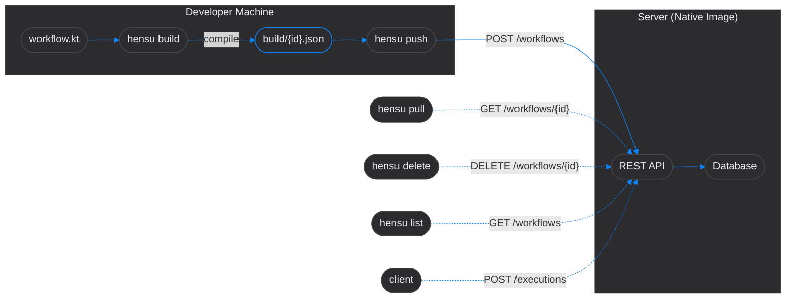
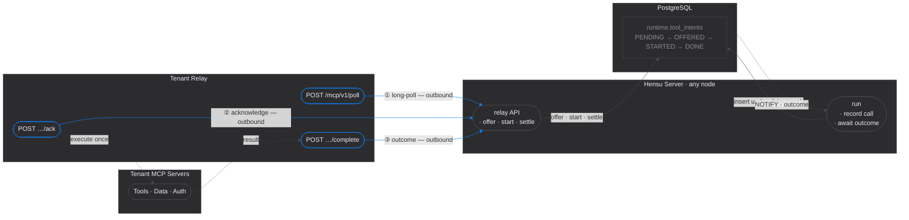
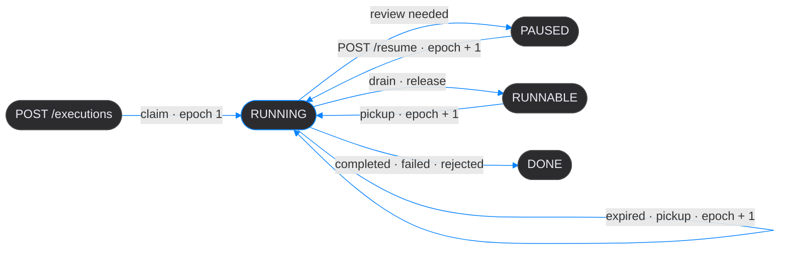
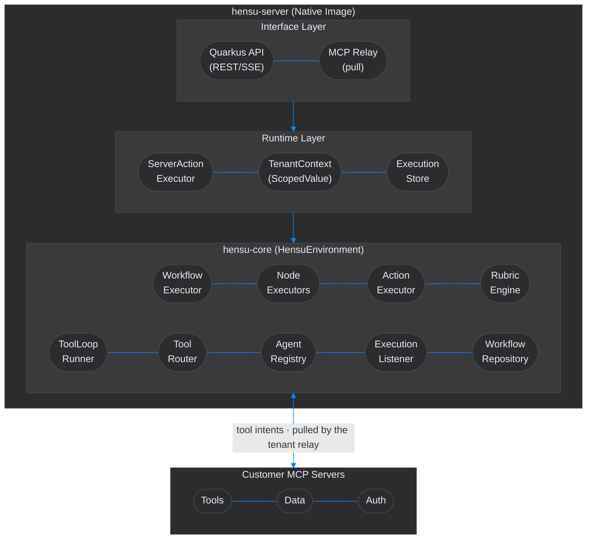
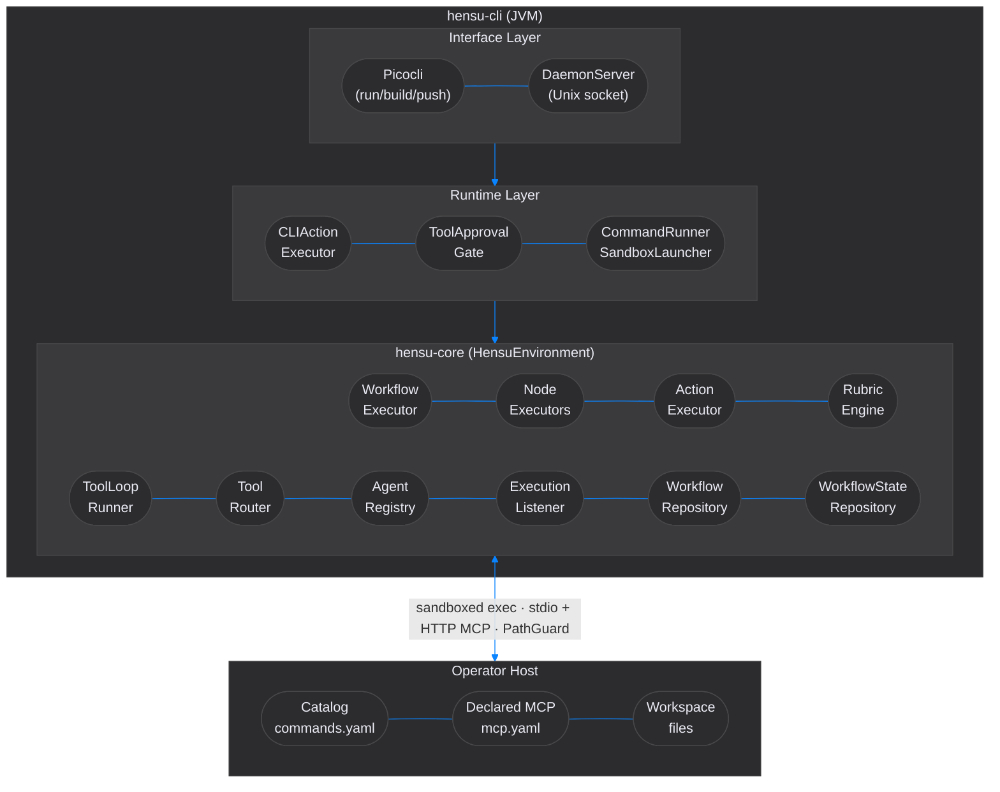
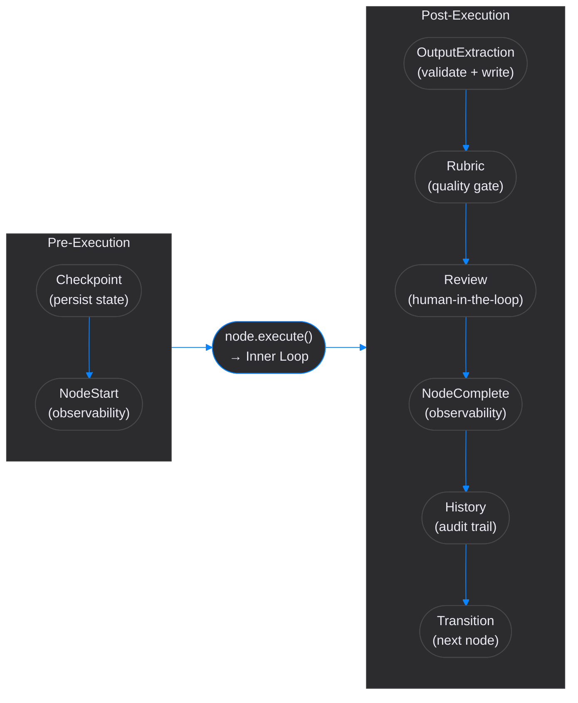
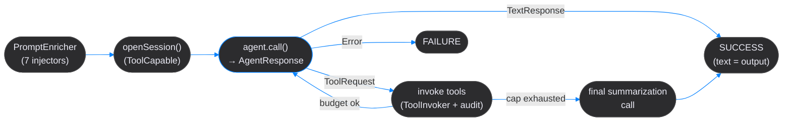
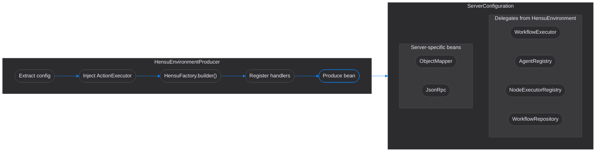

# Hensu Unified Architecture

**Hensu** separates the **authoring** of AI workflows from their **execution**. Developers describe agent behavior in a
type-safe Kotlin DSL, and a compiler produces portable JSON definitions. The same engine then executes those
definitions in one of **two runtimes**: a GraalVM native-image server that runs tenant workloads across a cluster, or a
JVM CLI that runs a workflow on the operator's own machine. Both embed `hensu-core` unchanged, and neither is a
degraded mode of the other.

**Two runtimes, one engine:**

| Runtime                     | Executes                                                         | How side effects reach the world                                                                                            | Packaging                                                          |
|:----------------------------|:-----------------------------------------------------------------|:----------------------------------------------------------------------------------------------------------------------------|:-------------------------------------------------------------------|
| **Server** (`hensu-server`) | Many tenants' workloads, multi-instance, claimed and recoverable | Tenant-owned MCP servers, through a relay that pulls tool calls. No shell, no `eval`, no user code on the box (Decision 3)  | GraalVM native image (Quarkus)                                     |
| **CLI** (`hensu-cli`)       | One operator's workloads, on that operator's own host            | A declared command catalog and local MCP servers under an OS sandbox, plus file tools contained by `PathGuard` (Decision 4) | JVM uber-jar plus launcher script – embeds the Kotlin DSL compiler |

The split is load-bearing rather than a packaging detail. It is the entire subject of Decisions 3 and 4, it is why one
`HensuFactory.builder()` produces two different wirings (Decision 2), and it is why "Hensu executes a workflow" has two
correct answers. Where a section applies to only one runtime, it says so in its title.

**Authoring and execution stay decoupled:**

| Layer             | Responsibility                    | Technology                                                      |
|:------------------|:----------------------------------|:----------------------------------------------------------------|
| **Definition**    | Author and compile workflow logic | Kotlin DSL → JSON artifacts, client-side only                   |
| **Orchestration** | Execute compiled workflows        | `hensu-core` – pure Java, zero dependencies – in either runtime |

**Workflows operate at two levels:**

- **Macro-Graph:** The static, declarative flow defined in the DSL — which nodes run, in what order, with what
  transitions. This is the **strategy**.
- **Micro-Tactics:** The dynamic execution logic within a single node — an **agent-native tool loop**
  (`ToolLoopRunner`) where the agent drives tool calls directly via `ToolCapable` / `ToolSession`. This is the **tactics**.

**The Architectural Core:** The engine is **pure Java** with **zero external dependencies**. Protocol handling (MCP),
provider integrations (LLMs), persistence, and security (multi-tenancy via `ScopedValues`) are pluggable modules wired
explicitly via `HensuFactory.builder()`.

---

## Key Architectural Decisions

### 1. Client-Side Compilation (Terraform/kubectl Pattern)

The server is deployed as a **GraalVM native image** - it cannot include the Kotlin DSL compiler.
Workflow compilation happens on the developer machine:



This diagram covers the **server** path only, which is why the developer machine appears in it as a build-and-push
client. It is not the whole picture of what the CLI does: `hensu run` compiles and then executes the workflow in
process, without a server being involved at all. Compilation is client-side in both runtimes because the Kotlin
compiler is a client-side thing; execution is a separate question, answered twice.

### 2. Centralized Bootstrap (`HensuFactory`)

All core components are assembled through a single builder — `HensuFactory.builder()` — that produces an immutable
`HensuEnvironment` container. This enforces a consistent wiring strategy across both runtimes:
agent providers, action executors, repositories, and configuration are resolved once at startup.

The builder is the only place where runtime-specific behavior diverges: both CLI and server wire the LangChain4j
provider for LLM access. The CLI additionally wires a local bash executor (`CLIActionExecutor`); the server wires
`ServerActionExecutor` that dispatches `Action.Send` to any registered `ActionHandler` (falling back to MCP for
unrecognized handlers) while rejecting `Action.Execute` (local bash), and delegates all components via CDI producers.
Each runtime also supplies its own `ToolProvider` instances, composed into the `ToolRouter` the engine calls for
agent tool use. The engine ships one of its own, `FileToolProvider`, whose file tools need no catalog and no launch.

See [Core Developer Guide](developer-guide-core.md) for usage patterns.

### 3. Tenant-Initiated Execution (Server: MCP Only)

This decision is about the **server** runtime specifically. The server is a **pure orchestrator** — it
has no shell, no `eval`, no script runner. All side effects (tool calls, database writes, API requests)
are routed to tenant-owned MCP servers through the tenant's **relay**, which pulls them from the
server. The CLI runtime executes locally and answers the same question a different way; see
Decision 4.

**The server holds no outbound MCP client, by design.** "This process opens no connection to a
tenant" is only provable while no client for one exists, so there is none to disable:
`McpToolProvider` records a tool call as a row in `runtime.tool_intents` and waits for its outcome,
and a call leaves the server only in the response to a request the tenant's relay made. Two MCP
paths exist in this codebase and are easy to confuse, so they are stated apart:

|            | Direction | Transport                                                            | Who dials              |
|------------|-----------|----------------------------------------------------------------------|------------------------|
| **Server** | inbound   | relay pull – long-poll `/mcp/v1/poll`, then `ack` and `complete`     | the tenant dials Hensu |
| **CLI**    | outbound  | stdio to a launched process, or Streamable HTTP to a declared `url:` | Hensu dials the server |

The CLI can dial out because the CLI is where the inverted risk is answerable: a credential store
holds the operator's secrets, an approval gate asks them before a call, and an audit file records
what happened. None of those exist on a multi-tenant host, which is the whole of the reason this
decision reads the way it does.

The relay protocol has four requests, each answered by any node:

- **Catalog:** the relay publishes its tools with `PUT /mcp/v1/catalog` under a version it chooses (the reference client uses a digest of the tool list). The catalog is stored in `runtime.mcp_catalogs`, so every node offers a run the same tools. A poll naming a version other than the published one is answered 409, and the relay republishes.
- **Poll:** `POST /mcp/v1/poll` waits up to `hensu.mcp.poll-wait` (25 s) for pending calls of the caller's tenant and returns up to 32, each under a fresh single-use offer token. A PostgreSQL `NOTIFY` wakes waiting polls on every node when a call is recorded, so the node a poll lands on does not matter.
- **Ack, then execute:** before running a task the relay posts `POST /mcp/v1/tasks/{token}/ack`. `204` means execute; `409` means do not – the offer lapsed after `hensu.mcp.ack-deadline` (10 s) and the call went back to the queue, or the call was settled or cancelled meanwhile. Only one token is ever acknowledged per call, so a relay that executes each acknowledged token once executes each call at most once, whatever the retries, nodes, or relay instances involved. Repeating an ack for the same token is safe and gets the same answer.
- **Complete:** the relay posts the MCP result or error to `POST /mcp/v1/tasks/{token}/complete`. The first outcome wins; a later one is answered 409 and is not recorded. A call acknowledged but not completed within `hensu.mcp.call-deadline` (60 s) settles as `TIMEOUT` – it may or may not have run – and a call no relay acknowledged within `hensu.mcp.dispatch-deadline` (5 min) settles as `UNAVAILABLE` – it did not run. The model is told which.
- **Identity:** every request is scoped to the authenticated tenant – the JWT `tenant_id` claim – never to a caller-supplied id. A relay sees, acknowledges and completes only its own tenant's calls; another tenant's token is answered as unknown.

A call is keyed by its position in the run, and its row is inserted under the run's claim epoch
(Decision 9), so a run that has lost its claim cannot issue one. A recovered run that replays up to
a call its predecessor already made finds the existing row and waits on its outcome instead of
issuing the call a second time.



All three requests (①, ②, ③) are **opened by the relay** — the accent arrows point *into* Hensu. A
tool call reaches the tenant only as the body of a poll response. Hensu never initiates a connection
to the tenant, so tenants expose **no inbound ports, no firewall rules, no VPN**.

Two consequences follow from the direction, and a deployment has to plan for both:

- **A tool call needs a relay, though not a connection.** A call waits in the table until a relay
  polls. A relay that is away for a moment – a deploy on either side, a network blip, a load
  balancer cutting an idle request – takes the call when it returns. A call no relay takes within
  the dispatch deadline settles as `UNAVAILABLE`, and the model is told the tool did not run.
  Unattended server-side runs therefore need the tenant's relay running, but not attached to any
  particular node.
- **The load balancer needs nothing special.** Runs and relays meet in PostgreSQL, so any node can
  run any execution and any node can serve any relay: no tenant affinity, no sticky sessions, no
  long-lived connections – a poll is an ordinary request that returns within the poll wait. The
  load balancer should honour the readiness check: a node that cannot reach PostgreSQL reports
  not-ready at `/q/health/ready` and answers its requests 503 with `Retry-After`, so a health-checked
  load balancer routes around it and a client retries elsewhere.

**The invariant is the direction, not the transport.** The split pipe – SSE down `/mcp/connect`,
POST up `/mcp/message` – was this decision's first implementation; relay pull replaced it without
touching the decision, which is the point. Every request being tenant-initiated is the property that
makes the security claim checkable – you verify it by confirming the server owns no client that can
reach a tenant – and that property survived a change of framing. A bidirectional stream such as
WebSocket or gRPC was the other candidate and was rejected: a stream lives in the memory of the node
holding it, which ties every call to that node and brings back the tenant affinity the split pipe
needed. Pulling through shared storage removed the affinity and the request-id correlation map
together. The analysis, model, and fault-injection results are in
[Multi-Node Execution Protocol](multi-node-execution-protocol.md).

The practical form for a reviewer is this. A proposal that keeps connections inbound-initiated is
inside Decision 3 whatever its wire format, and should be judged on its own merits. A proposal
that has the server dial out is outside Decision 3 however carefully its destination hosts are
allowlisted, because it trades a property you can prove for a policy somebody has to keep
verifying. Defend the direction; do not defend a transport.

The server holds no credential for a tenant's MCP servers and never executes user-supplied code.
The trust runs one way, though: a relay executes any call the server offers for a tool it
published, with the arguments the model wrote. Limiting what a call may do – which tools a relay
publishes, which arguments a tool accepts – belongs to the relay and the MCP servers behind it, not
to this decision. LLM output is not trusted either — `AgentOutputValidator` sanitizes all agent
responses for control characters, Unicode manipulation, and excessive payload size before the
output is written to workflow state. That sanitization is runtime-agnostic and applies to the CLI
as well.

### 4. Contained Execution (CLI: Catalog and Sandbox)

The CLI runs on the operator's own machine, and that is the product rather than an implementation
detail: an engine an operator can grant controlled reach into their own host – its files, its
processes, its network – for whatever the job happens to be. It therefore cannot borrow the server's
answer of "execute nothing locally". The question is not whether a process runs, but what an
operator granted it and what contains it.

Two mechanisms answer two different questions, and neither is sufficient alone.

**The catalog** (`commands.yaml`, compiled by `CommandRegistry` at startup) answers *which binary may
run, with which argument shape*. Entries compile at load time: executables resolve to absolute paths so
a later `PATH` change cannot swap them, argv templates are checked, and every parameter carries a
declared schema. One broken entry fails the whole file with its line number — there is no partial load,
because a half-loaded allowlist is one nobody has reviewed.

**`mcp.yaml`** is the same grant for a server rather than a binary: a declaration the operator wrote,
naming what may be launched and how far it reaches. It differs where a long-lived process forces it to —
containment is decided once, at launch, because a process that outlives the call cannot be contained per
call — and a server that is not installed is a runtime absence the run reports, not a load failure.

**The sandbox** (`SandboxLauncher`, applied by `CommandRunner`) answers *how far the process tree
reaches*. The per-entry policy compiles to kernel mechanisms — bubblewrap namespaces and bind mounts on
Linux, an SBPL profile under `sandbox-exec` on macOS — so it constrains children and grandchildren
rather than inspecting what the agent typed. Each call gets a private `$HOME`, the environment is
rebuilt from an allowlist instead of inherited, and `commands.yaml` / `mcp.yaml` are re-bound read-only
*after* the writable subtrees, so a command granted `write: ["."]` still cannot rewrite the catalog that
decides what it may run.

```mermaid
flowchart LR
    subgraph bg [" "]
        direction LR
        agent(["Agent tool call"])
        cat(["Catalog<br/>which binary"])
        rung(["Rung<br/>agent writes the line"])
        sbx(["Sandbox<br/>how far it reaches"])
        proc(["Process tree"])
    end

    agent --> cat
    agent --> rung
    cat --> sbx
    rung --> sbx
    sbx --> proc

    style bg    fill:#1c1c1e, stroke:none
    style agent fill:#2c2c2e, stroke:#48484a, color:#ebebf5, stroke-width:1px
    style cat   fill:#2c2c2e, stroke:#0A84FF, color:#ebebf5, stroke-width:1px
    style rung  fill:#2c2c2e, stroke:#48484a, color:#ebebf5, stroke-width:1px
    style sbx   fill:#2c2c2e, stroke:#0A84FF, color:#ebebf5, stroke-width:1px
    style proc  fill:#2c2c2e, stroke:#48484a, color:#ebebf5, stroke-width:1px

    linkStyle default stroke:#0A84FF, stroke-width:1px
```



Three command forms exist, and one of them is a deliberate exception:

| Form          | Command text written by | What the agent contributes                       |
|---------------|-------------------------|--------------------------------------------------|
| `exec:`       | the operator            | argv elements, bound whole — never syntax        |
| `shell: true` | the operator            | `HENSU_PARAM_*` values, which no shell re-parses |
| `rung: true`  | **the agent**           | the command line itself                          |

The first two make injection inexpressible rather than filtered: `execve` takes an array, so `&&`,
`$()`, and `|` inside an argument are inert bytes and there is nothing to escape. The rung gives that
property up on purpose, and the reasoning belongs here because it is the one place the model is not
safe purely by construction:

> **On a path where the agent authors the code being executed, the sandbox is the security boundary and
> the catalog governs grants rather than reachability.**

This is not a claim about software development. Many useful grants hand the agent a binary that
executes *content*: an interpreter runs a script, a build tool runs a build file, a migration runner
runs migrations, a query tool runs SQL. Wherever the agent can write that content, the catalog has
already granted arbitrary code execution inside the sandbox — it arrives as data rather than as a
command line, which changes how it looks and not what it can do. Refusing a rung on such a path buys
close to nothing in containment while taxing every honest step.

Unattended software development is the sharpest instance, and the one the policies are designed
against: the agent's whole job is editing the files a build then executes, and nobody is watching.
It is an instance of the rule, not its scope.

So the rung exists — it does not exist unless an operator declares it, it carries the
closed policy pinned in `CommandDefinition`'s constructor rather than merged from configuration, and
what it costs is legibility rather than containment: anything reached through it is invisible to
per-entry `unattended:` and `approval:` policy, and its audit record is an opaque command line rather
than a command id with bound parameters.

On every other path — deploy, release, migrate, anything whose code the agent did not author — the
catalog is a genuine allowlist and the statement above does not apply. The layer table is read per
path, not globally.

One structural guard backs all of it: `CommandRunner.bind` is the only place in the tree that builds a
`/bin/sh` command line, and `NoShellOnTheAgentPathTest` reads the sources and fails the build when a
second one appears. Containment is never optional — a host with no working backend does not run the
command unsandboxed. It demotes the call to approval, so a human can authorise that one uncontained
invocation, and refuses it outright in a run with nobody to ask. The deployment-wide override stays
`toolexec.allowUnsandboxed`, which logs loudly and is never a default.

Local stdio MCP servers launch under the same supervisor and the same policy schema. There is one
containment mechanism, not two.

A remote MCP server declared with `url:` has no process to contain, and no sandbox of ours reaches
another host — which is why a remote declaration refuses a `sandbox:` block rather than ignoring
one. Its bound is the set of hosts named across `mcp.yaml`: the remote analogue of "the catalog is
the allowlist". Within that set each connection is bound to the endpoint its own entry names —
scheme, host and port — because every request carries that server's bearer token: a redirect
anywhere else, including into another declared server, is refused as `DENIED` and the run continues.
Only a redirect that stays on the same endpoint is followed, once. Its credential is a **key** into the operator's credential store,
resolved at launch and injected into the connection, so the transport module never learns that a
credential store exists and no token reaches a log line, an audit row or an approval frame.

**Where a human fits, and where one does not.** The engine has no notion of human presence and does
not gain one: attendedness is a property of the runtime, which the CLI derives from
`--interactive` / `--unattended` and passes as a single boolean to `ToolApprovalGate`. That gate is
consulted by one `ApprovalToolProvider` decorator wrapping every discovered provider in the CLI's
producer, so the policy is written once rather than once per source, and a provider added later is
gated by being wrapped. The decorator reads the entry's own `unattended:` and `approval:`
declarations through `PreviewCapable`, which is also what lets a reviewer see the fully resolved
argv rather than the template.

An unattended run **refuses rather than escalates**. A refusal is not a failure, so
`ToolLoopRunner` appends a record to the reserved `_capability_gaps` state key and keeps
`_capability_gap_count` in step — and an ordinary `ConditionTransition` routes the blocked run,
because nodes do work and transitions route (Rule 9). Both keys are engine-owned: declaring either
in `writes` is a build error, or the agent's own output could erase the evidence that it was
blocked.

The profile half of this model is CLI-only, deliberately. Server-side MCP tools run ungated inside
the calling tenant's own catalog, where there is no reviewer to reach and containment belongs to the
tenant's server. The audit half is engine-wide: every invocation flows through the
`ExecutionListener` hooks and into a durable sink — `runtime.tool_audit` on the server, a JSON-lines
file on the CLI — composed unconditionally rather than behind the verbosity flag.

Operator-facing reference: [`docs/command-catalog.md`](command-catalog.md) and
[`docs/cli-tool-execution-security-model.md`](cli-tool-execution-security-model.md), which covers
the CLI side of it.

### 5. Non-Linear Graph Execution

Workflows are not limited to linear chains. The graph engine supports:

| Capability                | Mechanism                                                                                                                                                                                                                                                                                                                                                                                                                                                                                                                                                                                                                                                                                                 |
|:--------------------------|:----------------------------------------------------------------------------------------------------------------------------------------------------------------------------------------------------------------------------------------------------------------------------------------------------------------------------------------------------------------------------------------------------------------------------------------------------------------------------------------------------------------------------------------------------------------------------------------------------------------------------------------------------------------------------------------------------------|
| **Conditional branching** | `ScoreTransition` routes on rubric scores; `ConditionTransition` routes on any declared output variable via typed predicates (`onCondition` in DSL); `SuccessTransition` / `FailureTransition` route on result; `NoConsensusTransition` routes when a parallel node misses consensus; `AlwaysTransition` is the `otherwise` else-arm — catches every successful result the arms above it did not; `RubricFailTransition` for rubric-specific failure; `ApprovalTransition` for review-gated routing — on the human reviewer's verdict when one exists, else on the agent-written `approved`; `BoundedTransition` decorates any trigger with a per-node retry budget + escalation (the `revise` mechanism) |
| **Loops**                 | Condition-routed revise loops — a node re-executes itself under a bounded `revise` budget until an exit arm matches (the ralph-loop pattern)                                                                                                                                                                                                                                                                                                                                                                                                                                                                                                                                                              |
| **Parallel fan-out**      | `ParallelNode` executes branches concurrently on virtual threads                                                                                                                                                                                                                                                                                                                                                                                                                                                                                                                                                                                                                                          |
| **Fork / Join**           | `ForkNode` spawns independent parallel paths; `JoinNode` awaits and merges results                                                                                                                                                                                                                                                                                                                                                                                                                                                                                                                                                                                                                        |
| **Consensus**             | Majority vote, unanimous, weighted vote, or judge-decides strategies. Branches declare domain output via `yields()`. Vote strategies merge all branch yields; JUDGE_DECIDES merges only the winning branch's yields                                                                                                                                                                                                                                                                                                                                                                                                                                                                                       |
| **Backtracking**          | Review decisions can jump to any previous node, restoring state from execution history                                                                                                                                                                                                                                                                                                                                                                                                                                                                                                                                                                                                                    |
| **Sub-workflows**         | `SubWorkflowNode` delegates to another workflow by id with input/output mapping; `SubWorkflowGraphValidator` rejects cycles and dangling refs at push, `SubWorkflowNodeExecutor.MAX_DEPTH = 16` bounds recursion, `_tenant_id` propagates into the child                                                                                                                                                                                                                                                                                                                                                                                                                                                  |
| **Pause / Resume**        | Any node returning `PENDING` checkpoints state (node position and context); `executeFrom()` resumes from snapshot. The SSE stream is closed on pause (reviews may take days); clients re-subscribe after submitting a resume                                                                                                                                                                                                                                                                                                                                                                                                                                                                              |

For non-agent steps, `GenericNode` runs custom synchronous logic registered by `executorType`;
`ActionNode` dispatches asynchronous tasks to external systems via a registered `ActionHandler`
(e.g., webhooks, git operations, notifications).

### 6. Structured Concurrency (Preview API)

All parallel execution – `ParallelNodeExecutor`, `ForkNodeExecutor` – uses Java's
`StructuredTaskScope` (preview, JEP 453) instead of raw `ExecutorService`.
This is a deliberate trade-off: preview API in exchange for three structural guarantees.

**Why preview:** `StructuredTaskScope` enforces a parent–child relationship between the
spawning thread and its subtasks. When the scope closes, all subtasks are guaranteed to have
completed or been canceled – there is no "fire and forget" leak path. With raw
`ExecutorService`, a forgotten `Future` or a missed `shutdown()` silently leaks threads.
In a workflow engine where every fork spawns N virtual threads running LLM calls, that leak
compounds per execution.

**What it buys us:**

| Guarantee                          | `ExecutorService`                        | `StructuredTaskScope`          |
|:-----------------------------------|:-----------------------------------------|:-------------------------------|
| Subtask lifetime bounded by parent | Manual (`shutdown` + `awaitTermination`) | Automatic (scope close)        |
| First failure cancels siblings     | Manual (`Future.cancel` loop)            | Built-in (`ShutdownOnFailure`) |
| Thread dumps show parent–child     | No – flat pool                           | Yes – structured hierarchy     |

**Operational consequence:** `--enable-preview` is required everywhere – Gradle compile tasks,
CLI launcher scripts, daemon `ProcessBuilder`, Quarkus dev mode, and native image build args.
The install scripts and build config handle this automatically; manual `java -jar` invocations
must include the flag.

Each parallel execution creates and closes its own `StructuredTaskScope` within the node
executor method, scoped to that single fork/parallel operation. No shared thread pool exists.

### 7. Quality Gates (Rubric Evaluation)

Node outputs can be evaluated against markdown rubric definitions before the workflow transitions. The
`RubricEngine` coordinates evaluation through `ScoreExtractingEvaluator`, which reads the `score`
engine variable written directly to context by the agent's synthesis step — no JSON parsing required.
`ScoreTransition` rules route based on thresholds, enabling self-correcting loops where low-scoring
outputs are sent back for revision. The evaluator also accumulates feedback into the `recommendation`
engine variable; `FeedbackContextInjector` then surfaces it to the next agent automatically as a
`### Previous Feedback` section whenever the feedback is preserved across the transition (backtracking
`revise` arms preserve it; a plain forward `goto` clears it unless marked `withFeedback`).

### 8. Storage Architecture

Repository interfaces and in-memory defaults live in **hensu-core**:

- `WorkflowRepository` (`io.hensu.core.workflow`) — Tenant-scoped workflow definition storage
- `WorkflowStateReader` / `WorkflowStateRepository` (`io.hensu.core.state`) — Tenant-scoped execution state queries, and the writable repository built on them

`HensuFactory.builder()` wires in-memory implementations by default, and deployments substitute
database-backed ones through the builder. The server's `WorkflowRepository` is delegated from
`HensuEnvironment` via `@Produces @Singleton`. The server has no `WorkflowStateRepository`: a run
writes its state only through `ExecutionStore`, under its claim (Decision 9), and the store serves
the API's queries as the `WorkflowStateReader`, so no write can bypass the claim.

**What is kept, and for how long.** A run's working state – the journal and its tool intents –
lives only as long as the run needs it; the durable record of each tool call is the audit row, whose
arguments are redacted at the source. Nothing is purged by age yet: execution rows and both audit
sinks grow until an operator deletes them
([`docs/tickets/execution-retention-policy.md`](tickets/execution-retention-policy.md)).

| Data                                                                                     | Kept until                                                                                                                                               |
|------------------------------------------------------------------------------------------|----------------------------------------------------------------------------------------------------------------------------------------------------------|
| Execution row (`context`, `history`, phase)                                              | Kept indefinitely – no retention policy yet                                                                                                              |
| Journal (model turns, nested-flow checkpoints)                                           | The main flow checkpoints past it; all of it when the execution pauses or finishes                                                                       |
| Tool-call arguments (`runtime.tool_intents`)                                             | The call settles. They are unredacted while the call is open, `sensitive` parameters included, so PostgreSQL is inside the trust boundary for open calls |
| Tool-call results (`runtime.tool_intents`)                                               | The execution pauses or finishes – only a replay of the call's own attempt reads them                                                                    |
| Intent rows (key, tool, argument digest, status)                                         | Their execution row is deleted (`ON DELETE CASCADE`)                                                                                                     |
| `runtime.tool_audit` (redacted arguments, output)                                        | Kept indefinitely – the lasting record; no retention policy yet                                                                                          |
| CLI `~/.hensu/tool-audit.log` (one JSON line per call: redacted arguments, argv, output) | Kept indefinitely – appended to and never rotated                                                                                                        |

The statements that delete and clear each of these are in the step journal section of
[`docs/multi-node-execution-protocol.md`](multi-node-execution-protocol.md#step-journal).

### 9. Distributed Execution & Recovery

Several server nodes run behind an ordinary load balancer, all active, sharing one PostgreSQL. Any
node accepts any request; which node runs an execution is decided by a **claim** on its row in
`runtime.execution_states`, never by where a request landed. The fault model, the invariants, the
TLA+ model checked with TLC, and the fault-injection test are in
[Multi-Node Execution Protocol](multi-node-execution-protocol.md); this section states what the
protocol guarantees and how.

| Column             | Meaning                                                                                                                                     |
|:-------------------|:--------------------------------------------------------------------------------------------------------------------------------------------|
| `run_state`        | `RUNNING` – a node holds a claim and runs it; `RUNNABLE` – released, waiting for any node; `PAUSED` – waiting for a review decision; `DONE` |
| `claim_epoch`      | Incremented by every claim; every write a run makes compares it                                                                             |
| `claim_owner`      | Label of the node holding the claim – for operators; nothing compares it                                                                    |
| `claim_expires_at` | Written and judged by the database clock alone                                                                                              |
| `step`             | Node attempts the main flow has completed; names the journal position of the next one                                                       |



| Component                | Responsibility                                                                                                                                                                              |
|:-------------------------|:--------------------------------------------------------------------------------------------------------------------------------------------------------------------------------------------|
| `ExecutionStore`         | Every claim transition and every write a run makes, each one SQL statement fenced on `claim_epoch` (`JdbcExecutionStore`, or `InMemoryExecutionStore` with the same state machine)          |
| `RunRegistry`            | The runs live on this node and their claims: renews them, preempts a run whose claim is gone, releases every claim when the node shuts down                                                 |
| `ClaimRenewalJob`        | Every `hensu.claim.renew-interval` (`10s`) – extends every live claim on this node by `hensu.claim.ttl` (`30s`) in one statement                                                            |
| `ExecutionPickupJob`     | Every `hensu.claim.pickup-interval` (`5s`) and on a `hensu_runnable` notification – claims released and expired executions, up to `hensu.claim.max-runs` (`200`) per node, and resumes them |
| `ExecutionRunner`        | Runs one execution under its claim – binds the claim, the tenant, and the journal for the run – and settles its outcome                                                                     |
| `IntentDeadlineJob`      | Every second – returns lapsed offers to the queue and settles calls as `TIMEOUT` or `UNAVAILABLE` (Decision 3)                                                                              |
| `PgNotificationListener` | `LISTEN` on the wake-up channels; a notification is a hint to re-read the database, never data, and a missed one costs at most a second                                                     |

**Fencing is per claim, not per node.** Every write a run makes – checkpoint, journal record, tool
intent, settlement – compares its claim's epoch in the same statement, so a run that has lost its
claim – frozen past the TTL, partitioned from the database, overtaken by a pickup – has its next
write refused with `RunPreemptedException` and stops. Two runs of one execution on the same node are
fenced as surely as two on different nodes. A journal record or intent is inserted under a
`FOR SHARE` lock on the execution row, so no claim can change between the fence check and the insert.

**No clock but the database's.** A claim's expiry is written as `now() + ttl` and judged against
`now()`, both in PostgreSQL. A node whose clock is wrong can neither take a live claim nor keep a
dead one: node clocks decide only when to renew. A node that has failed to renew for longer than the
TTL preempts its own runs, since another node may already hold them.

**No tool call without a claim, and none twice.** A run records a tool call as an intent under its
claim's epoch before any relay can see it, so a run that has lost its claim cannot issue one. Calls
are keyed by their position in the run, so the run that recovers an execution finds the intents its
predecessor made and waits on their outcomes instead of issuing them again; the relay's
acknowledgement makes execution at-most-once (Decision 3).

**Recovery replays what it cannot reproduce.** A checkpoint is written before each node attempt.
Between checkpoints, the model turns of the attempt in progress and the checkpoints of nested flows
– fork branches and sub-workflows – are journaled in `runtime.execution_journal` under the claim; a
parallel branch is one agent call, so it journals its turns under its own scope and takes no
checkpoint. A recovered run resumes from the last checkpoint and replays the journaled turns
instead of asking the model again, so it reaches the same tool calls with the same arguments, and a
nested flow resumes from its own last checkpoint instead of starting over. A replay that reaches a
recorded call with different arguments has diverged; it fails with `ReplayDivergenceException`
rather than issue a different call under the same key. Each main-flow checkpoint prunes the journal
behind it.

**Pickup is the only recovery path.** A node that shuts down releases each claim to `RUNNABLE` and
notifies the cluster, so another node resumes the execution within a pickup cycle; the readiness
check reports the node not-ready from the moment it starts draining. A node that dies leaves its
claims to expire after the TTL. `FOR UPDATE SKIP LOCKED` spreads a simultaneous sweep across nodes
instead of making them queue on the same rows.

**Start and resume are durable before they answer.** `POST /executions` inserts the execution with
its claim before answering `202`, so an accepted execution survives a crash before its first
checkpoint. A client that may retry a start sends an `Idempotency-Key`: the insert and the key
check are one statement, so retries create one execution between them, wherever they land, and
each is answered with it; a different request reusing the key is refused with 422. `POST /resume` claims the `PAUSED` execution before reading it, so two concurrent
resumes cannot both run it; a decision that does not apply to the snapshot puts it back to `PAUSED`.
Resuming an execution that is not paused answers 409, and an unknown one 404.

**Events and status are cluster-wide.** Execution events are published on the PostgreSQL channel
`hensu_events` and delivered to subscribers on every node, so an event stream works wherever the
load balancer sends it; an event too large for a notification is truncated and marked so, and the
full state is always readable from the execution resource. Status and results are read from the
database.

**Concurrency safety**: each transition is a single `UPDATE … WHERE … RETURNING`. Under PostgreSQL's
default `READ COMMITTED` isolation, the second of two concurrent claimants of a row waits for the
first, re-evaluates its `WHERE` against the committed row, finds the state or epoch changed, and
claims nothing. No application-level lock is involved.

The `%inmem` test profile uses the in-memory store and disables the scheduler entirely
(`%inmem.quarkus.scheduler.enabled=false`).

**Server vs CLI daemon review semantics:** The server's `PAUSED` state is stateless — the run
gives up its claim and the execution waits for an external `POST /resume` call. The CLI daemon's `AWAITING_REVIEW` state
is **not terminal** (`isTerminal() == false`): the execution's virtual thread remains alive and
blocked, holding no claim but retaining in-process state. A client `hensu attach` resumes the
review inline without replaying from a checkpoint.

### 10. REST API Separation

All path/query identifiers are validated by `@ValidId`; the `Idempotency-Key` header by `@ValidIdempotencyKey`; workflow request bodies by `@ValidWorkflow`
(deep-validates the entire object graph for safe identifiers and control-character-free text);
free-text inputs by `@ValidMessage`. `LogSanitizer` strips CR/LF at every log call site.
Violations return `400 Bad Request`. See [Server Developer Guide — Input Validation](developer-guide-server.md#input-validation).

```
/api/v1/workflows    → WorkflowResource (definition management - CLI integration)
├── POST   /                    Push workflow (create/update; validates sub-workflow graph under push lock)
├── GET    /                    List workflows
├── GET    /{workflowId}        Pull workflow
└── DELETE /{workflowId}        Soft-delete workflow (sets deleted_at; FK constraints prevent hard-delete)

/api/v1/executions   → ExecutionResource (runtime operations - client integration)
├── POST   /                          Start execution (202 Accepted — async; progress via SSE)
├── GET    /{executionId}             Get execution status
├── GET    /{executionId}/events      Subscribe to execution events (SSE stream)
├── POST   /{executionId}/resume      Resume paused execution
├── GET    /{executionId}/result      Get final output (public context, _-keys stripped)
├── GET    /paused                    List paused executions
└── GET    /events                   Subscribe to all tenant execution events (SSE stream)

/mcp/v1                  → McpRelayResource (tenant relay pull, Decision 3; every request scoped to the tenant claim)
├── PUT    /catalog                       Publish the relay's tool catalog under a version
├── POST   /poll                          Long-poll for the tenant's pending tool calls (409 when the named catalog version is not the published one)
├── POST   /tasks/{token}/ack             Acknowledge an offer before executing it (204 execute, 409 do not)
└── POST   /tasks/{token}/complete        Record the outcome of an acknowledged call (409 when already settled, 404 for an unknown token)
```

---

## Runtime Architectures

Two runtimes, one engine. The `hensu-core` block is byte-identical in both diagrams below —
everything wrapped around it is what differs. Read them as a pair.

### Server Runtime

Multi-tenant, clustered, and reaching the outside world only through the tenant's own MCP servers.



### CLI Runtime

Single-operator, in-process, and reaching the outside world through grants the operator declared on
that same host. The interface layer is a terminal and a Unix socket rather than HTTP; the runtime
layer contains rather than forwards; the repositories are the in-memory defaults, so execution state
lives and dies with the process (the daemon is what keeps it alive between commands).



Placing them side by side makes the actual difference legible: the server's runtime layer exists to
**forward** a side effect to somebody else's machine, and the CLI's exists to **contain** one on this
machine. Everything below that line is shared.

---

## Module Structure

### hensu-core (Pure Execution Engine)

Zero-dependency Java library — the engine both runtimes embed. It is not itself a runtime: it has no
main method, no transport, and no opinion about where a side effect lands. Contains:

- `HensuFactory` / `HensuEnvironment` — Builder and container for all core components
- `WorkflowExecutor` — Graph traversal, node dispatch, pause/resume via `executeFrom()`
- `NodeExecutorRegistry` — Pluggable node type executors
- `AgentRegistry` / `AgentFactory` — Agent management with explicit provider wiring
- `ActionExecutor` — Pluggable action dispatch (Send/Execute)
- `ToolCapable` / `ToolSession` — Narrow interface for agents that support tool sessions; `ToolSession` is call-scoped (not stateful on the agent) for `ParallelNodeExecutor` safety
- `ToolLoopRunner` — Stateless driver dispatched from `AgentLifecycleRunner` when a node declares tools and the agent implements `ToolCapable`. Iterates the sealed `AgentResponse` hierarchy (`TextResponse` = done, `ToolRequest` = continue, `Error` = done), invoking each tool through the context's `ToolInvoker` and reporting every request and outcome to the `ExecutionListener`. Enforces `AgentConfig.maxToolCalls` budget (default 10, counting executed calls). Cap exhaustion → one final summarization call → `SUCCESS` or hard `FAILURE`
- `ToolCallResult` / `ToolCallStatus` — Record `(toolName, status, output, error, exitCode)` with a derived `success()`; the status is one vocabulary across every layer, so a refusal, a timeout and a broken tool stay distinguishable
- `ToolProvider` / `ToolInvoker` — Runtime-agnostic tool seam: a provider owns a catalog and the invocation of the tools in it. `settledTools()` reports only what is already live, so composing a router never forces a lazy provider to start what it manages
- `BuiltInToolProvider` — Marker for a provider present without anyone opting into it: the engine's own file tools, which yield a contested name instead of failing start-up
- `ToolRouter` — Composes providers into one surface implementing both `ToolRegistry` and `ToolInvoker`. A provider that throws while reporting its catalog is skipped rather than propagated, so one unreachable source fails a node instead of the execution; duplicate tool names across configured providers are rejected, while a built-in name a configured provider also claims is dropped with a warning
- `ToolRegistry` / `ToolDefinition` — Protocol-agnostic tool descriptors used by agent-native tool loops and MCP integration; the registry is discovery-only
- `RubricEngine` / `ScoreExtractingEvaluator` — Quality evaluation: reads `score` engine variable
  from context; accumulates feedback into `recommendation`; no JSON parsing
- `EngineVariables` — SSOT for engine variable names (`score`, `approved`, `recommendation`)
- `AgentLifecycleRunner` — Composition-based agent call: prompt enrichment → execution → output extraction. When the node declares tools and the agent implements `ToolCapable`, dispatches to `ToolLoopRunner` for agent-native tool execution
- `EngineVariablePromptEnricher` — Composite enricher running 7 injectors before each agent call:
  `FeedbackContextInjector` → `RubricPromptInjector` → `ScoreVariableInjector` →
  `ApprovalVariableInjector` → `RecommendationVariableInjector` → `WritesVariableInjector` →
  `YieldsVariableInjector`. `FeedbackContextInjector` runs first and surfaces preserved feedback
  as a `### Previous Feedback` section.
  Score/Approval/Recommendation injectors fire for both transition-based nodes and consensus branches
  (via `BranchExecutionConfig.needsSelfScoring()`)
- `WorkflowRepository` / `WorkflowStateReader` / `WorkflowStateRepository` — Tenant-scoped storage interfaces with in-memory defaults
- `HensuState` / `HensuSnapshot` / `ExecutionHistory` — Mutable runtime state, immutable checkpoints, execution trace
- Workflow model, Node types (including `SubWorkflowNode`), Transition rules
- `WorkflowValidator` (`workflow/validation`) — validates transition targets exist unconditionally; validates `writes` and prompt `{variable}` refs against schema when declared
- `SubWorkflowGraphValidator` (`workflow/validation`) — cycle + dangling-ref detection across the sub-workflow reference graph, single-DFS with `globallyVisited`; `SubWorkflowNodeExecutor` enforces `MAX_DEPTH = 16` and propagates `_tenant_id` into the child context

### hensu-dsl (Kotlin DSL)

Kotlin DSL for workflow definitions. Contains:

- `HensuDSL.kt` - Top-level `workflow { }` entry point
- `KotlinScriptParser` - Compiles `.kt` files via embedded Kotlin compiler
- Type-safe builders for all node types, transitions, and configurations
- `Models` constants for supported AI model identifiers

**Client-side only.** Never runs on the server (no Kotlin compiler in native image).

### hensu-server (Native-Image Execution Runtime)

The first runtime. Extends the engine with HTTP, MCP, multi-tenancy, and durable state — everything
that only makes sense when the workflow belongs to somebody who is not at the keyboard:

- `HensuEnvironmentProducer` — CDI producer using `HensuFactory.builder()`
- `ServerConfiguration` — Delegates core components from `HensuEnvironment` via `@Produces @Singleton`
- `ServerActionExecutor` — Send-action dispatcher for DSL-authored actions (routes to registered handlers; rejects `Action.Execute`). Agent tool calls do not pass through it
- `WorkflowService` — Service layer facade: start/resume executions, snapshot management
- `WorkflowRegistryService` — Push pipeline: wraps save in `WorkflowPushLock` and invokes `SubWorkflowGraphValidator` lazily resolving sub-workflow ids through the repository
- `WorkflowPushLock` — Cluster-wide push mutex (`pg_advisory_xact_lock` with JVM `ReentrantLock` fallback) preventing concurrent pushes on different nodes from introducing cycles
- `WorkflowResource` — Workflow definition management (push/pull/delete/list)
- `ExecutionResource` — Execution runtime (start/resume/status)
- `McpRelayResource` / `McpToolProvider` / `ToolIntents` / `McpCatalogs` — Inbound relay pull: a tool call is a durable intent the tenant's relay polls for, acknowledges, and completes through any node; the server opens no connection to a tenant
- `TenantContext` — Java 25 `ScopedValue` carrying tenant identity for the scope of a request; `TenantContext.runAs()` is the safe propagation entry point
- `ExecutionStore` / `RunRegistry` / `ExecutionRunner` / `ExecutionPickupJob` / `ClaimRenewalJob` — Multi-node execution: epoch-fenced claims judged by the database clock, the step journal, renewal, drain, and pickup (Decision 9)
- `PgNotificationListener` / `PgEventBus` — PostgreSQL `LISTEN`/`NOTIFY` wake-ups between nodes and cluster-wide execution event delivery
- `JdbcWorkflowRepository` — PostgreSQL-backed workflow definitions (JSONB); execution state lives in `JdbcExecutionStore`

### hensu-langchain4j-adapter (LLM Provider Bridge)

Bridges `hensu-core`'s `Agent` / `AgentProvider` abstraction with LangChain4j model implementations:

- `LangChain4jProvider` — `AgentProvider` that creates `LangChain4jAgent` instances from `AgentConfig`
- `LangChain4jAgent` — Wraps a LangChain4j `ChatModel` as a Hensu `Agent`; implements `ToolCapable` to support agent-native tool loops
- `LangChain4jToolSession` — `ToolSession` implementation with multi-tool queue draining and `ReentrantLock`-guarded history (virtual-thread safe)
- Programmatic `ChatModel` construction via builders (not CDI) – requires explicit native-image registration in `hensu-server` (`LangChain4j*NativeConfig` classes)

Wired by both CLI and server via `HensuFactory.builder().agentProviders(List.of(new LangChain4jProvider()))`.

### hensu-serialization (JSON Serialization)

Jackson-based JSON serialization shared by CLI and server:

- `WorkflowSerializer` - Entry point: `toJson()`, `fromJson()`, `createMapper()`
- `HensuJacksonModule` - Custom serializers/deserializers for Node, TransitionRule, Action type hierarchies
- Jackson mixins for builder-based deserialization (Workflow, AgentConfig, ExecutionStep, NodeResult, BacktrackEvent, ExecutionHistory)
- GraalVM-safe: explicit registrations via `SimpleModule` (no reflective scanning)

### hensu-cli (JVM Execution Runtime)

The second runtime, not a thin client for the first. It compiles workflows, and it also executes them
on the operator's machine with no server involved — `hensu push` / `pull` / `list` / `delete` are the
subset of its surface that talks to a server at all. Shipped as a JVM uber-jar with a launcher script
rather than a native image, because it embeds the Kotlin compiler and a native image cannot.

- Uses `hensu-dsl` for Kotlin DSL compilation (workflow.kt → JSON)
- `hensu run` — Execute a workflow (daemon-aware; inline fallback)
- `hensu validate` — Validate workflow syntax and detect unreachable nodes
- `hensu visualize` — Render workflow graph as text or Mermaid diagram
- `hensu build` — Compile DSL to JSON (`{working-dir}/build/`)
- `hensu push` / `pull` / `delete` / `list` — Server workflow management
- `hensu daemon` (start / stop / status) — Background daemon lifecycle
- `hensu ps` / `attach` / `cancel` — Daemon execution management
- `hensu credentials` (set / list / unset) — API key management
- Local execution — a full `HensuEnvironment` in this process, on the in-memory repository defaults
- `HensuEnvironmentProducer` (CLI variant — wires `LangChain4jProvider`, `CLIActionExecutor`, and every discovered `ToolProvider` behind one `ApprovalToolProvider` decorator)
- `DaemonReviewHandler` / `CLIReviewHandler` / `ReviewTerminal` — Human-in-the-loop review over the daemon socket or inline
- `io.hensu.cli.sandbox` — `CommandRunner` (two-phase prepare/execute), `SandboxLauncher` with bubblewrap and Seatbelt backends, `ProcessProbe`: the contained execution path of Decision 4

#### Daemon Architecture

The CLI ships a background `DaemonServer` to eliminate JVM and Kotlin compiler cold-start latency.
`DaemonClient` communicates with it over a **bidirectional** Unix domain socket
(`~/.hensu/daemon.sock`). Workflow executions run in virtual threads inside the warm JVM; output is
buffered in an `OutputRingBuffer` so clients can detach (`Ctrl+C`) and re-attach (`hensu attach`)
without losing output.

**Interactive review over the socket:** When a node declares a review gate
(`review(ReviewMode.REQUIRED)`), the daemon sends a
`review_request` frame to the attached client and blocks the execution's virtual thread until a
`review_response` frame arrives. `DaemonReviewHandler` coordinates this lifecycle:

- If a client is attached, it renders the review prompt via `ReviewTerminal` and collects
  Approve / Reject / Backtrack decisions.
- If the client detaches (`Ctrl+C`) mid-review, the execution remains in `AWAITING_REVIEW` —
  the virtual thread stays blocked until a new client attaches and submits a response, or the
  30-minute timeout rejects the review. The timeout fails closed: nobody was reached, so nobody
  approved, and approving on an absent reviewer's behalf would grant exactly what the checkpoint
  existed to withhold.
- `CLIReviewHandler` provides the inline (non-daemon) fallback for `--no-daemon` runs.

---

## Core Concepts

### 1. Macro-Graph (DSL Level)

The static workflow defined by users:

```kotlin
workflow("OrderProcessing") {
    agents { ... }

    graph {
        start at "validate"

        node("validate") { ... }
        node("process") { ... }
        node("notify") { ... }

        end("complete")
    }
}
```

### 2. Micro-Tactics (Node Level)

Internal execution strategy within a node:

**Agent-Native Tool Loop:**

When a node declares `tools` and its agent implements `ToolCapable`, `AgentLifecycleRunner` dispatches
to `ToolLoopRunner`. The agent drives tool calls directly — the sealed `AgentResponse` hierarchy controls
flow: `TextResponse` terminates with success, `ToolRequest` continues the loop, `Error` terminates with
failure. Budget enforced by `AgentConfig.maxToolCalls` (default 10, counting executed calls not round-trips).
Tools are invoked through the context's `ToolInvoker`, wired from the same `ToolRouter` as the
catalog so an agent can never be handed tools it does not execute against. Every request and
outcome reaches the `ExecutionListener` as a `ToolCallEvent` / `ToolResultEvent` pair. The records
are bounded, deep-copied and redacted at the source, and each runtime consumes them: the server
logs them and republishes them as `tool.invoked` / `tool.settled` SSE events, the CLI prints them
under `--verbose`.

```kotlin
node("research-topic") {
    agent = "researcher"
    tools = listOf("search", "analyze", "summarize")
    maxToolCalls = 15

    prompt = "Research {topic} comprehensively"
    onSuccess goto "publish"
    onFailure goto "fallback"
}
```

### 3. The Execution Loop

`WorkflowExecutor` wraps every node traversal in a **processor pipeline**:

**Outer Pipeline** (`ProcessorPipeline`) — every node traversal:



Any processor can short-circuit by returning a terminal `ExecutionResult`.

**Inner Execution** — what `node.execute()` runs for `StandardNode`. `AgentLifecycleRunner` enriches
the prompt, then dispatches to `ToolLoopRunner` when the node declares tools and the agent implements
`ToolCapable`; otherwise it runs a single agent call.

**Tool Loop** (`ToolLoopRunner`):



### 4. State Schema Validation

Workflows optionally declare a `WorkflowStateSchema` — a typed registry of domain variables
(`writes` declarations) and their expected types. At load time, `WorkflowValidator` performs
two categories of checks: **structural** — every transition target must reference an existing
node in the workflow — and **schema** — all node `writes` declarations and prompt template
bindings (e.g., `{orderId}`) must be declared in the schema. Structural validation runs
unconditionally; schema validation is a no-op when no schema is declared.

Three **engine variables** (`score`, `approved`, `recommendation`) are predefined in
`WorkflowStateSchema.ENGINE_VARIABLES` — `writes()` rejects them at build time and again at load
time, and declaring one in `state { }` is redundant. They are injected into and extracted from context automatically by the
`EngineVariablePromptEnricher` pipeline and `OutputExtractionPostProcessor`.

Each domain variable can carry an optional `description` — a plain-English hint for the LLM:

```kotlin
state {
    input("topic",   VarType.STRING)
    variable("article", VarType.STRING, "the full written article text")
}
```

`WritesVariableInjector` reads these descriptions from the schema and appends structured output
requirements to the agent prompt, so the LLM knows exactly what format each written field expects.

### 5. Execution Observability (SSE)

Workflow visibility is provided via Server-Sent Events, separate from the MCP relay protocol.
`ExecutionEventBroadcaster` receives engine events (`node.started`, `node.completed`,
`execution.completed`, etc.) and fans them out to HTTP clients subscribed via `ExecutionEventResource`.
In a multi-node deployment the events travel between nodes on the PostgreSQL channel `hensu_events`,
so a subscriber receives them whichever node runs the execution (Decision 9).

To safely route events from background virtual threads back to the correct execution, the broadcaster
binds the current `executionId` in a Java 25 `ScopedValue` — no `ThreadLocal`, no manual ID passing.

---

## Server Initialization

The server wires core infrastructure through CDI:



---

## GraalVM Design Constraints

Hensu is deployed as a **GraalVM native image** — this is not just a deployment detail, it shapes
core architecture. GraalVM performs static analysis at build time; patterns that require runtime
reflection, classpath scanning, or dynamic class generation fail silently or crash.

### The No-Go List (hensu-core)

| Pattern                                     | Problem                              | Rule                                          |
|:--------------------------------------------|:-------------------------------------|:----------------------------------------------|
| `Class.forName()` / `field.setAccessible()` | Requires runtime reflection metadata | Never in `hensu-core`                         |
| `Proxy.newProxyInstance()`                  | Generates classes at runtime         | Never                                         |
| Jackson `@JsonTypeInfo(use = CLASS)`        | Encodes class names as strings       | Never; use `SimpleModule` type discriminators |
| Classpath scanning / `ServiceLoader`        | Scans at runtime                     | Explicit wiring via `HensuFactory.builder()`  |

### Quarkus Relaxations (hensu-server)

Quarkus extensions generate GraalVM metadata at build time, so these patterns work safely
within `hensu-server`:

- CDI injection (`@Inject`, `@Produces`) — ArC resolves beans at build time
- `@ConfigProperty` — processed at build time
- JAX-RS resources (`@Path`, `@GET`) — REST layer is build-time wired
- LangChain4j AI services — `quarkus-langchain4j` extensions register metadata

### Explicit Wiring as a Design Principle

The prohibition on classpath scanning is why `HensuFactory.builder()` uses explicit wiring.
`AgentProvider`, `NodeExecutorRegistry`, and `ActionExecutor` instances are declared at call
sites — GraalVM's static analysis can follow every reference.

Classes in `hensu-core` that Jackson needs reflectively (builder constructors, setter methods)
are registered in `CoreModelNativeConfig` in `hensu-server` via `@RegisterForReflection`. No
Quarkus or Jackson annotations ever enter `hensu-core`.

See [Server Developer Guide — GraalVM Native Image](developer-guide-server.md#graalvm-native-image).

---

## Jackson Serialization Contract

### The Core Boundary Rule

`hensu-core` contains **zero Jackson imports**. Domain models (`Workflow`, `Node`, `AgentConfig`)
are plain Java records and builder classes — no `@JsonProperty`, `@JsonDeserialize`,
`@JsonTypeInfo`. This is a deliberate decoupling contract: the core engine is a pure Java
library, testable and deployable without any JSON framework.

### How Serialization Is Wired

`hensu-serialization` owns the entire Jackson configuration:

| Component            | Role                                                                                                                                                                                 |
|:---------------------|:-------------------------------------------------------------------------------------------------------------------------------------------------------------------------------------|
| `WorkflowSerializer` | Entry point: `toJson()`, `fromJson()`, `createMapper()` — the single `ObjectMapper` factory                                                                                          |
| `HensuJacksonModule` | `SimpleModule` registering custom serializers/deserializers for `Node`, `TransitionRule`, `Action`, `ExecutionPhase` hierarchies plus `WorkflowStateSchema` — no reflective scanning |
| `mixin/` package     | Jackson mixins enabling builder-based deserialization without annotating core models                                                                                                 |

`WorkflowSerializer.createMapper()` is the **single `ObjectMapper` factory** for CLI and server.
`ServerConfiguration` exposes it as a CDI bean via `@Produces @Singleton`.

### GraalVM Implication

Jackson mixins are a runtime event — Quarkus cannot trace them at build time. `CoreModelNativeConfig`
in `hensu-server` is the single `@RegisterForReflection` registration point for all `hensu-core`
builder classes that the mixin machinery needs.

See [hensu-serialization Developer Guide](developer-guide-serialization.md) for the `treeToValue` rule.

---

## Testing Strategy

Each layer has a dedicated testing approach exercising real code at the appropriate scope. Both
runtimes are covered, and they are covered differently: the server's risk is wiring, SQL, and tenant
isolation, so it is tested by booting it; the CLI's risk is what a granted process can reach, so it
is tested by running commands against real sandbox backends.

### Unit Tests (Pure JVM)

Isolated class tests using Mockito. `StubAgentProvider` returns a `StubAgent` backed by
`StubResponseRegistry` for agents declaring the model `stub`, and in stub mode (priority 1000) for
every agent. No AI API calls, no network, no containers.

### CLI Runtime Tests (Pure JVM)

`hensu-cli` tests are plain JUnit 5 with Mockito and no containers; `ToolProviderWiringTest` is the
single `@QuarkusTest`, and it exists to assert the CDI wiring — that every discovered `ToolProvider`
reaches the engine wrapped in the approval decorator, including one added later.

A few of them guard properties that no amount of careful coding preserves on its own:

- `NoShellOnTheAgentPathTest` scans the Java sources of both `hensu-cli` and `hensu-core` and fails
  the build if a shell command-line construction site appears anywhere outside `CommandRunner`.
  Nothing is launched — it is a structural assertion about the codebase.
- `SandboxContainmentTest` launches genuinely contained processes and asserts on the result: writes
  outside the declared subtrees are refused, `$HOME` is private, undeclared network is blocked, and
  background processes do not outlive the call. Containment is measured against the kernel rather
  than against the policy object.
- `SeatbeltProfileTest` asserts the generated SBPL text everywhere — deny-default first, the
  read-only catalog re-bind ordered after the writable subtrees — and asserts actual `sandbox-exec`
  behavior only where it can run.
- `CommittedCatalogTest` loads the repository's own `working-dir/commands.yaml`. That file lives
  outside the module, so `hensu-cli/build.gradle.kts` declares it as an explicit task input —
  otherwise Gradle would report the test task up to date and a broken catalog would pass the build
  meant to catch it.

The behavioral halves are platform-gated (`@EnabledOnOs`, plus an availability probe that skips when
the backend is absent), so bubblewrap is exercised on Linux and Seatbelt on macOS. A single-platform
run proves containment for that platform and only the profile text for the other one.

### Server Integration Tests (Quarkus InMemory)

`@QuarkusTest` with `@TestProfile(InMemoryTestProfile.class)` boots the full server — API,
CDI wiring, `WorkflowExecutor`, `TenantContext` — against in-memory repositories. The `inmem`
profile disables PostgreSQL, Flyway, and the scheduler (no Docker required).

All integration tests extend `IntegrationTestBase`, which provides CDI injection, a per-test reset
of stubs and workflows, and helpers (`registerStub`, `pushAndExecute`, `snapshotOf`). Executions are
not deleted between tests, since the server has no write outside a claim; each test reads its own
by id.

### Server Repository Tests (Testcontainers PostgreSQL)

Tests in `io.hensu.server.persistence` extend `JdbcRepositoryTestBase`, which starts a real
PostgreSQL container and runs Flyway migrations — no Quarkus context involved. These tests
cover CRUD, UPSERT semantics, FK constraints, tenant isolation, claim fencing, the step journal,
tool-intent state transitions, and pickup.

### Test Coverage Map

| Layer              | Mechanism                          | Scope                                                    |
|:-------------------|:-----------------------------------|:---------------------------------------------------------|
| Unit               | Mockito, pure JVM                  | Class-level logic, edge cases                            |
| CLI runtime        | Pure JUnit + real sandbox backends | Catalog compilation, containment, approval wiring, audit |
| Server integration | `@QuarkusTest` + inmem profile     | CDI wiring, API contracts, end-to-end workflow logic     |
| Server persistence | Testcontainers + Flyway            | SQL correctness, schema migrations, tenant isolation     |

---

## Summary

The unified architecture provides:

1. **Pure Core** — Zero-dependency Java engine, protocol-agnostic
2. **Build-Then-Push** — Client-side compilation (Kotlin DSL → JSON); server receives pre-compiled artifacts
3. **Centralized Bootstrap** — `HensuFactory.builder()` as the single entry point for all core infrastructure
4. **Two Runtimes** — The server has no shell and routes every side effect via registered `ActionHandler`s (MCP by default) to tenant clients. The CLI executes locally through the `commands.yaml` allowlist under an OS sandbox; where the agent authors the executed code, the sandbox is the boundary and the catalog governs grants. Its agent-facing surface is three sources — catalog commands, `mcp.yaml` servers, and built-in file tools that run in-process and are contained by `PathGuard` rather than by the kernel
5. **Non-Linear Graphs** — Condition-routed loops with bounded revise budgets, conditional branches, fork/join, parallel fan-out with consensus, backtracking
6. **Structured Concurrency** — `StructuredTaskScope` (preview) for all parallel execution; no `ExecutorService`, no thread pool lifecycle
7. **Rubric Evaluation** — Quality gates that score outputs and route on thresholds for self-correcting loops
8. **Pause / Resume** — Workflows checkpoint at any node and resume via `executeFrom()`. Claim fencing keeps a stale run from writing over the run that replaced it
9. **Distributed Recovery** — Epoch-fenced claims expired by the database clock, a step journal that recovered runs replay, and tool calls as durable intents executed at most once
10. **Sub-Workflows** — Hierarchical composition via `SubWorkflowNode` with input/output mapping; `SubWorkflowGraphValidator` rejects cycles and dangling refs at push (under `WorkflowPushLock`); recursion bounded by `MAX_DEPTH = 16`; tenant isolation preserved across the boundary via `_tenant_id` propagation
11. **Agent-Native Tool Loop** — `ToolLoopRunner` via `ToolCapable` / `ToolSession` for direct tool driving with budget enforcement, fed by runtime-supplied `ToolProvider` instances and audited through the `ExecutionListener`
12. **Human Review** — Checkpoints for manual approval at node execution level
13. **Multi-Tenancy** — Java 25 `ScopedValues` for safe tenant context propagation and isolation
14. **Storage in Core** — Repository interfaces with in-memory defaults; server delegates via CDI
15. **Shared Serialization** — `hensu-serialization` provides consistent JSON format; zero Jackson in `hensu-core`
16. **API Separation** — Workflow definitions and executions are distinct REST resources
17. **GraalVM-First Design** — No-reflection core; explicit wiring enables static analysis
18. **Three-Layer Testing** — Unit (Mockito), Integration (inmem + stubs), Persistence (Testcontainers)
19. **Workflow Validation** — `WorkflowValidator` enforces transition target existence unconditionally; `WorkflowStateSchema` adds typed variable declarations and prompt binding checks at load time
20. **Execution Observability** — `ExecutionEventBroadcaster` fans out engine events to SSE subscribers; `ScopedValue` routes events across virtual threads without `ThreadLocal`
21. **CLI Daemon** — `DaemonServer` keeps the JVM and Kotlin compiler warm; `OutputRingBuffer` allows detach/re-attach without losing execution output
