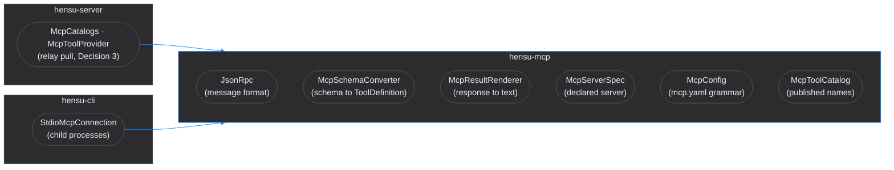

# Hensu MCP

Runtime-agnostic Model Context Protocol surface shared by the CLI and the server.

## Overview

The `hensu-mcp` module holds the parts of MCP that do not depend on which runtime opens a
connection: the JSON-RPC message format, the translation between MCP's JSON Schema and the
engine's `ToolDefinition`, the rendering of a `tools/call` response into text an agent can read,
the `mcp.yaml` grammar, and the catalog that turns the servers' tool lists into one set of
published names.

Transport stays with whoever owns it. The server never connects to an MCP server: a tenant's relay
publishes its tool catalog and pulls tool calls from the server, so the server needs only the schema
conversion and the result rendering. The CLI connects itself – stdio servers launched as child
processes through `StdioMcpConnection`, remote ones over Streamable HTTP. Everything both runtimes
share lives here and neither reimplements it.

The stdio client lives here rather than in the CLI because it is protocol work, but it must not
drag a sandbox implementation into a module the server also compiles against. It therefore takes
the containment it applies to a launch as a `UnaryOperator<List<String>>`, and the CLI passes its
own `SandboxLauncher` in.

The module carries no CDI annotations and no framework types. Its classes are plain objects each
runtime constructs or calls directly.



## Entry Points

### `JsonRpc` — message construction and parsing

```java
JsonRpc jsonRpc = new JsonRpc(mapper);

String request = jsonRpc.createRequest(id, "tools/call", params);
Map<String, Object> result = jsonRpc.parseResult(responseJson);   // throws McpException on error
```

A JSON-RPC `error` answer raises `McpErrorResponseException`, which keeps the server's `error`
object whole (`code`, `message`, `data`) so a relay can forward it as received. A `result` that is
not a JSON object is refused as an ordinary `McpException`, so one broken server costs only its own
tools.

Parsing stays on Jackson's tree model (`readTree`), never data binding, so no reflective
deserialization enters the native image. The class is deliberately not a CDI bean: the server
exposes it via a `@Produces` method in `ServerConfiguration`, and the CLI constructs one.

### `McpSchemaConverter` — MCP schema to engine model

```java
ToolDefinition tool = McpSchemaConverter.convert(descriptor);
```

Reads the parts of JSON Schema the engine can act on — property name, `type`, `description`,
`default`, and membership in the schema's `required` array. Richer constructs are left to the MCP
server to enforce. A malformed schema degrades to "no parameters" rather than throwing, so one bad
descriptor cannot take down a whole catalog.

Discovered parameters are never marked `sensitive`: MCP has no way to express that a value is a
secret, and claiming otherwise would make the audit trail redact values the server itself
publishes in plain schema. Only locally declared tools can make that claim.

### `McpResultRenderer` — response to agent-readable text

```java
ToolCallResult result = McpResultRenderer.toResult(toolName, response);
```

An MCP result is an ordered array of typed content blocks. Passing that map to a model directly
would put a Java `Map.toString` — braces, equals signs, identity hashes — into the context window.
The renderer flattens it instead:

| Block                       | Rendered as                                  |
|-----------------------------|----------------------------------------------|
| `text`                      | its text, in array order, one per line       |
| `image`, `audio`            | `[image: image/png]`                         |
| `resource`, `resource_link` | `[resource: file:///etc/hosts (text/plain)]` |
| unrecognized payload        | canonical JSON                               |

Non-text blocks carry bytes a text completion cannot consume, so only the block type and whatever
locates it survive. A response setting `isError: true` becomes `ToolCallStatus.FAILURE` carrying
the rendered text as its error message, so the agent sees what went wrong.

### `McpConfig` — the `mcp.yaml` grammar, in two dialects

```java
List<McpServerSpec> servers = McpConfig.load(workingDirectory, McpConfig.Dialect.CLI);
```

Both runtimes that read `mcp.yaml` parse it here, so they cannot disagree about what a declaration
means. `Dialect.CLI` accepts the whole grammar. `Dialect.RELAY` refuses `sandbox:`, `unattended:`
and `approval:`, because a relay launches no sandboxed process and has no operator to ask; it does
not reinterpret them. A malformed document is a `MiniYamlException` naming the line.

A `tools: {allow: [...], deny: [...]}` block narrows what a server publishes. Both lists name tools
the way the server lists them, before `prefix:`. An empty `allow:` and a name in both lists are load
errors.

### `McpToolCatalog` — one set of published names

```java
McpToolCatalog<R> catalog = McpToolCatalog.<R>empty()
        .with(route, connection.listTools(), notices::add);
```

Applies each server's `tools:` filter and `prefix:`, then the first-declared-wins rule for names
two servers share, in that order, so a filtered tool claims no name. Every tool left out against the
declaration's intent produces one operator-facing notice: an illegal name, a collision, an
`allow:` entry the server does not list, or a filter entry written with the prefix. A `deny:` entry
written that way still withholds the tool it names. The catalog is generic over the runtime's
`Route`, and keeps the server's own descriptors beside the engine's definitions, because a relay
publishes descriptors.

### `StreamableHttpMcpConnection` — a remote endpoint

```java
McpConnection connection = StreamableHttpMcpConnection.open(
        spec, BearerCredential.fixed(token), allowedHosts, client);
```

A `BearerCredential` supplies the token for each request. On a `401`, a credential that yields a
different token through `afterRejection` gets one resend, since a request refused at authorization
never reached the tool; a `403` is never resent. `BearerCredential.NONE` sends no `Authorization`
header. Only a `307` or `308` redirect on the connection's own endpoint is followed: any other
status may come after the server ran the call, and any other endpoint would receive this server's
credential.

### `CallControl` — cancellation and caller `_meta`

```java
CallControl control = CallControl.withMeta(Map.of("com.example/trace", traceId));
connection.callTool(name, arguments, control);   // control.cancel() from any thread
```

`callTool` takes a `CallControl`; `CallControl.none()` is for callers that never cancel. A cancel
stops the call the way the transport defines: closing the response stream in the modern era,
`notifications/cancelled` in the legacy era and over stdio. Caller `_meta` merges under the era's
own keys, and a key in the protocol's `io.modelcontextprotocol/` namespace is an
`IllegalArgumentException`.

Every `McpException` carries a `delivery()`: `NOT_SENT` when the request certainly never reached
the server – a refused connection, a `401` or `403`, a refused redirect that asked for a resend, a
cancel or expired budget that stopped the send before it began, a stdio server found dead before
the write – and `MAYBE_DELIVERED` otherwise.

### `StdioMcpConnection` — a server process this run owns

```java
McpConnection connection = StdioMcpConnection.open(
        spec, workingDirectory, launcher::wrapForServer, System.getenv());
```

Launches the declared argv, speaks line-delimited JSON-RPC over the child's standard input and
output, and kills the process tree on `close()`. Five properties follow from the server outliving
any single call:

- **Containment is applied once, at launch.** A long-lived process cannot be sandboxed per request,
  so the caller supplies the wrapper and decides — before starting anything — what happens when no
  backend is available.
- **The environment is hermetic.** The child starts empty and receives
  `HermeticEnvironment.PASSTHROUGH` plus the server's own `env:`. Nothing that authenticates the
  operator reaches an MCP server.
- **Each request carries its own deadline.** `McpServerSpec.requestTimeoutMs` bounds every
  `tools/list` and `tools/call`; a lapsed request drops its correlation entry, tells the server
  with `notifications/cancelled`, and raises `McpException` instead of pinning the workflow thread.
- **Coming up is budgeted apart from answering.** The `initialize` handshake is bounded by
  `McpServerSpec.startupTimeoutMs`, measured from the fork, because a server's first reply costs
  whatever its runtime costs to boot — `npx` resolving a package, an interpreter starting. Sharing
  one number with `requestTimeoutMs` would force a deployment that wants calls to fail fast into a
  launch budget no real server survives.
- **Standard error is drained.** A server that logs would otherwise block on a full pipe and look
  like a hang.

## Module Structure

```
hensu-mcp/src/main/java/io/hensu/mcp/
├── BearerCredential.java            # The token a request carries, and its successor after a 401
├── CallControl.java                 # A caller's cancel and _meta for one tools/call
├── EndpointBound.java               # Whether a redirect stays on the connection's own endpoint
├── HttpExchanger.java               # Bounded JSON-RPC exchanges with one Streamable HTTP endpoint
├── HttpReply.java                   # One HTTP answer, reduced to the JSON-RPC message it carried
├── JsonRpc.java                     # JSON-RPC 2.0 message construction and tree-model parsing
├── ListedTools.java                 # One tools/list result: descriptors plus mirrored headers
├── McpConnection.java               # Connection contract + McpToolDescriptor record
├── McpEgressDeniedException.java    # A redirect off its own endpoint or outside the host allowlist
├── McpEra.java                      # Sealed: what differs between protocol revisions
├── McpErrorResponseException.java   # A JSON-RPC error answer, its error object kept whole
├── McpException.java                # Protocol, connection, and tool-invocation failures, with delivery()
├── McpInvalidArgumentException.java # An argument with no form its mirrored header can carry
├── McpParameterHeaders.java         # x-mcp-header: validate annotations, build Mcp-Param-* headers
├── McpProtocol.java                 # Revisions Hensu speaks, headers, _meta keys, error codes
├── McpResultRenderer.java           # tools/call response to ToolCallResult
├── McpSchemaConverter.java          # MCP JSON Schema to ToolDefinition, raw schema carried through
├── McpServerSpec.java               # Sealed: Stdio | Http, as a deployment declared it, + ToolFilter
├── McpToolCatalog.java              # Servers' tool lists to published names: filter, prefix, collisions
├── SseFrames.java                   # Reads the awaited JSON-RPC message out of an SSE body
├── StdioMcpConnection.java          # stdio: launch, speak JSON-RPC, kill the tree
├── StreamableHttpMcpConnection.java # Streamable HTTP: POST one endpoint, JSON or SSE back
└── config/
    └── McpConfig.java               # mcp.yaml grammar, CLI and RELAY dialects
```

Test fixtures live in `src/testFixtures`: `FakeMcpServer` is a real process the stdio tests launch,
and `FakeHttpMcpServer` is a loopback endpoint on the JDK's own `HttpServer` that the HTTP tests
drive. The CLI reuses both rather than growing a second copy of either.

`src/mcpRevisionTest` lists, calls and cancels against real servers pinned to each revision Hensu
has to reach: the reference `everything` server on 2024-11-05, 2025-06-18, 2025-11-25 and
2026-07-28, and a Spring AI MCP server, each built into a container image. It needs Docker and the
network, so it is not part of `check`; CI runs it as the `mcp-revisions` job.

```bash
./gradlew :hensu-mcp:mcpRevisionTest
```

## Two eras of one transport

Revision 2026-07-28 removed `initialize`, `notifications/initialized` and session identifiers, and
moved client identity into each request's `_meta`. Everything before it did the opposite. A hosted
endpoint deployed today is overwhelmingly on the earlier revision, and one deployed next year will
not be, so `StreamableHttpMcpConnection` probes: it sends a modern request first and falls back to
the handshake when the answer identifies an older server. It never issues a `GET` — the ladder that
follows one leads to the deprecated two-endpoint HTTP+SSE transport, which this module does not
implement and says so when an endpoint speaks neither era.

`McpEra` is a sealed interface rather than a boolean so the compiler checks that every difference is
handled: which headers a POST carries, whether `_meta` is injected, whether a session identifier is
echoed, and how a cancelled or timed-out request is cancelled. In the modern era, closing the response stream
*is* the cancellation; in the legacy era, a `notifications/cancelled` goes out under a short fixed
budget of its own.

## Parameters mirrored into headers

A modern server may mark a tool parameter with `x-mcp-header`, and every call must then repeat that
argument in an `Mcp-Param-{Name}` header. A gateway can then route on the header without reading
the body, and the server answers `400` with `-32020` (`HeaderMismatch`) when the two disagree.
`McpParameterHeaders` owns both halves:

- **At listing**, it checks every annotation against the spec. The name must be an HTTP token and
  must be unique regardless of case. The parameter must be a string, integer or boolean. It must
  be reached from the schema root through `properties` alone, never through `items`, a composition
  keyword or a `$ref`. A tool that fails a check is left out of the catalog rather than failing the
  server, and the reason is available through `McpConnection.catalogNotices()`. The CLI prints it
  as a tool-source notice.
- **At call time**, it reads each annotated argument at its exact path, renders it as text and
  encodes it. An absent or `null` argument sends no header. A value that is not header-safe travels
  as `=?base64?…?=`, and `Mcp-Name` uses the same encoding. An argument with no header form throws
  `McpInvalidArgumentException` before anything is sent: an object, a list, a fraction, or an
  integer beyond ±2^53−1. The CLI maps that exception onto `VALIDATION_FAILED`, so the agent can
  correct the argument.

A `-32020` means the server's schema changed after it was listed. The connection lists the tools
again and retries once, but only when that tool's annotations actually changed. Only the modern
era mirrors. The annotation postdates the legacy revision, so a legacy connection ignores it.

## Consumers

| Runtime        | Transport                          | Provider                                            | Status |
|----------------|------------------------------------|-----------------------------------------------------|--------|
| `hensu-server` | inbound relay pull, per tenant     | `McpToolProvider` — the tenant relay's catalog      | wired  |
| `hensu-cli`    | outbound stdio and Streamable HTTP | `DeclaredMcpToolProvider` — servers from `mcp.yaml` | wired  |

The server holds no MCP client by design: a tool call is a durable intent that the tenant's relay
polls for, acknowledges and completes, so no code path in the server opens a connection to a tenant.
See Decision 3 in `docs/unified-architecture.md`.

Each contributes a `ToolProvider` to the engine's `ToolRouter`, so an agent cannot tell which
transport produced a result. That is the reason the rendering rules above live in this module
rather than beside either transport.

## Dependencies

- `hensu-core` (API dependency) — for `ToolDefinition`, `ToolCallResult`, `ToolCallStatus`
- Jackson BOM 2.20.1 (`jackson-databind`) — resolved by the Quarkus BOM inside `hensu-server`
- Test: JUnit 5, AssertJ; the revision suite adds Testcontainers, versioned by the Quarkus BOM

## See Also

- [Server Developer Guide](../docs/developer-guide-server.md) — MCP transport, tenant scoping, dynamic tool discovery
- [Core Developer Guide](../docs/developer-guide-core.md) — the `ToolProvider` seam and the agent tool loop
